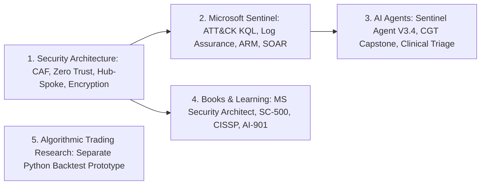

# Surya — Engineering Portfolio & Technical Catalogue

**Cybersecurity Architect | Microsoft Sentinel & AI Agents | Technical Author**

This catalogue indexes my public security architecture designs, Microsoft Sentinel detection and onboarding tooling, AI agent engineering prototypes, technical books, and algorithmic trading research.

---

## Browse by Practice Area

| Category | Catalogue Page | Scope & Visitor Access |
| :--- | :--- | :--- |
| **1. Security Architecture** | [**`security-architecture.md`**](security-architecture.md) | **Public source:** [Microsoft vs. CrowdStrike Enterprise AI/DR Architecture Comparison](https://github.com/86sunbot/fde-lab/blob/main/microsoft_vs_crowdstrike_ai_dr_guide.md). **Public case study (implementation currently private):** Azure CAF landing zone patterns, Entra ID Conditional Access persona matrices, Hub-Spoke/Azure Firewall/Private Link topologies, PMK/CMK/CPK encryption designs, and HLD/ADR templates (`azure-security-framework`). |
| **2. Microsoft Sentinel** | [**`sentinel.md`**](sentinel.md) | **Public case studies (implementations currently private):** Six MITRE ATT&CK v14 KQL detection specifications (`sentinel-detection-engineering`), 3-way log onboarding reconciliation and synthetic canary checks (`Sentinel-Log-Validation-Agent`), a 10-stage PowerShell 7 / ARM greenfield orchestrator (`Sentinel-as-a-Service`), and Managed-Identity Logic App SOAR playbooks (`security-automation`). |
| **3. AI Agents & Applied Engineering** | [**`ai-agents.md`**](ai-agents.md) | **Public source and demo instructions:** CGT patient-to-batch orchestration console ([`FDE-Final-Capstone`](https://github.com/86sunbot/FDE-Final-Capstone)), clinical report triage prototype ([`caldera-monitoring-triage`](https://github.com/86sunbot/caldera-monitoring-triage)), and RAG assistant + V1 Sentinel prototype ([`fde-lab`](https://github.com/86sunbot/fde-lab)). **Public case studies (implementations currently private):** Sentinel Detection Engineering Agent V3.4 (`ai-agent-usecase-deployment`) and LLM/RAG threat models (`ai-security-lab`). |
| **4. Books & Learning** | [**`books-and-learning.md`**](books-and-learning.md) | **Public articles & chapter outlines (manuscripts and `cissp-knowledge-base` currently private):** Chapter indices, syllabus mappings, and lab runbook designs for four unpublished self-authored manuscripts (*Microsoft Security Architect Master Blueprint v1.1*, *SC-500 Complete Study Guide v1.1*, *Surya Master CISSP Guide*, and *AI-901 Study Guides*) plus public LinkedIn technical articles. |
| **5. Algorithmic Trading Research** | [**`trading-research.md`**](trading-research.md) | **Public case study (implementation currently private):** Separate personal research practice documenting a new October 2026 pure-Python backtesting prototype (`compute_cpr`, `compute_rsi`, next-bar open breakout execution with basis-point transaction costs). |
| **Experience & Credentials** | [**`experience-and-impact.md`**](experience-and-impact.md) | Career roles (EY GDS, Accenture, Cognizant), repository mapping, and active [ISC2 CISSP verification](https://www.credly.com/badges/5c478c9e-77f0-4227-9251-69ecb1d639e5). |

---

## Representative Examples to Inspect First

### 1. Projects with Public Source and Demo Instructions
- **CGT Patient-to-Batch Control Tower ([`FDE-Final-Capstone`](https://github.com/86sunbot/FDE-Final-Capstone)) — Public source and demo instructions:** Run `START_DEMO.command` or `uvicorn fde_capstone.api:app` to inspect three synthetic end-to-end orchestration POCs, out-of-order bitemporal event reconciliation, SHA-256 hash-chained SQLite audit verification, opaque bearer-token mutation auth, and seven read-only persona lenses (automated tests run via `pytest`).
- **Clinical Monitoring Report Triage ([`caldera-monitoring-triage`](https://github.com/86sunbot/caldera-monitoring-triage)) — Public source and demo instructions:** Follow the [Sprint Walkthrough](https://github.com/86sunbot/caldera-monitoring-triage/blob/main/docs/FDE_SPRINT_STORY_AND_WALKTHROUGH.md) and [10-Minute Demo Script](https://github.com/86sunbot/caldera-monitoring-triage/blob/main/docs/DEMO_PRESENTATION_SCRIPT.md) (web app via `npm run dev`; scoped slice in [`README.md#1-todays-scoped-slice-locked-at-0915`](https://github.com/86sunbot/caldera-monitoring-triage#1-todays-scoped-slice-locked-at-0915)) to inspect Curveball 1–3 resilience controls (EDC boundary filtering, Site Registry HTTP 500 hold, partial eTMF outage `[N of M reports]` denominator disclosure) and verbatim `SourceCitation` provenance (`document_id`, `page_number`, `verbatim_sentence`); run automated tests via `pytest tests/ -v --tb=short`.
- **Document Assistant, Sentinel V1 Prototype & AI/DR Architecture Comparison ([`fde-lab`](https://github.com/86sunbot/fde-lab)) — Public source and demo instructions:** Inspect the FastAPI + Streamlit RAG assistant (`document-assistant/versions/v3-enterprise-assistant`), the V1 password-spray detection prototype (`sentinel-usecase-deployment`), and the [Microsoft vs. CrowdStrike Enterprise AI/DR Architecture Comparison](https://github.com/86sunbot/fde-lab/blob/main/microsoft_vs_crowdstrike_ai_dr_guide.md) (automated tests run via `pytest`).

### 2. Public Case Studies (Implementations Currently Private)
- **MITRE ATT&CK v14 KQL Detection Library ([`sentinel.md#3-sentinel-detection-engineering-library-sentinel-detection-engineering`](sentinel.md#3-sentinel-detection-engineering-library-sentinel-detection-engineering)) — Public case study with implementation currently private:** Summarizes six detection rule designs (`T1621`, `T1078`, `T1550.002`, `T1098.003`, `T1530`, `T1071.004`), entity mappings (`Account`, `IP`, `Host`), the 100-point quality rubric, and static YAML schema validation scope.
- **Three-Way Telemetry Reconciliation & Canary Pipeline ([`sentinel.md#1-sentinel-log-validation-agent-sentinel-log-validation-agent`](sentinel.md#1-sentinel-log-validation-agent-sentinel-log-validation-agent)) — Public case study with implementation currently private:** Summarizes how `Sentinel-Log-Validation-Agent` separates `PASS`, `WARN`, `FAIL`, and `UNKNOWN` (zero-volume) telemetry states and flags `SHADOW`, `SILENT`, and `UNASSOCIATED_DCR` assets.
- **Governed AI Rule Generation & Readiness Gate ([`ai-agents.md#1-ai-assisted-microsoft-sentinel-detection-engineering-agent-ai-agent-usecase-deployment-v34`](ai-agents.md#1-ai-assisted-microsoft-sentinel-detection-engineering-agent-ai-agent-usecase-deployment-v34)) — Public case study with implementation currently private:** Summarizes the 5-stage workflow connecting Log Analytics schema discovery, candidate KQL generation, static anti-pattern validation, backtesting, and SHA-256-gated `enabled=false` deployment.
- **Azure Zero Trust Architecture & Technical Books ([`security-architecture.md`](security-architecture.md) · [`books-and-learning.md`](books-and-learning.md)) — Public case studies and chapter outlines with repositories/manuscripts currently private:** Reviews Conditional Access persona matrices, Hub-Spoke + Private Link DNS architecture, PMK/CMK/CPK key hierarchies, unpublished book chapter structures, and the public [How NOT to Design Microsoft Sentinel](https://www.linkedin.com/feed/update/urn:li:activity:7434462569752571904/) article.

---

## Credentials, Contact & Governance

- **Author:** Sharat P Surya (`Surya PS`), CISSP — Bengaluru, India
- **Active Certification:** [CISSP — Certified Information Systems Security Professional (ISC2)](https://www.credly.com/badges/5c478c9e-77f0-4227-9251-69ecb1d639e5) *(Verified Credly Badge · Valid 16 Jan 2026 – 31 Jan 2029)*
- **LinkedIn:** [linkedin.com/in/surya-ps-cissp-a5a097160](https://www.linkedin.com/in/surya-ps-cissp-a5a097160/)
- **GitHub Profile:** [github.com/86sunbot](https://github.com/86sunbot)
- **Portfolio Governance, Source-of-Truth Model & Maturity Taxonomy:** [`MAINTENANCE.md`](MAINTENANCE.md)
