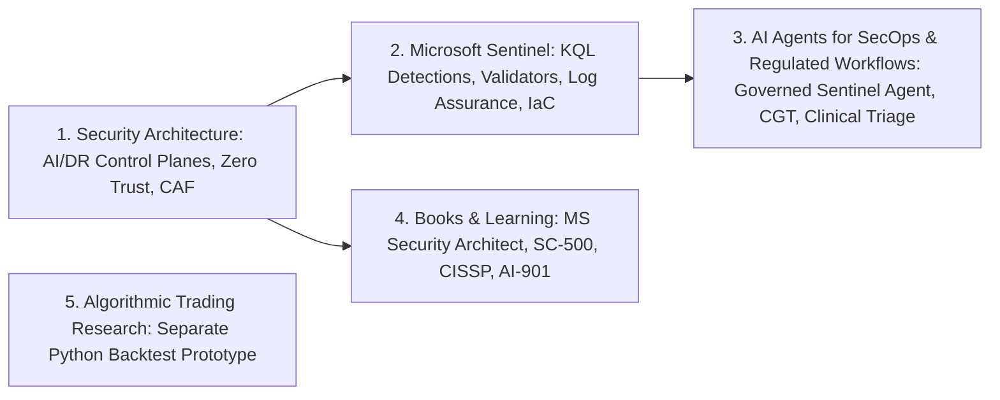

# Surya — Engineering Portfolio & Technical Catalogue

**Cybersecurity Architect | Microsoft Sentinel & AI Agents | Technical Author**

This catalogue is the single public entry point for my cybersecurity architecture designs, Microsoft Sentinel detection and onboarding tooling, governed AI agent workflows, technical books, and separate algorithmic trading research.

---

## Three Public Flagship Examples (Inspect Source & Run Locally Now)

| Flagship Domain | Public Source & Inspectable Artifact | Portfolio Deep Dive | Verification & Reproduction |
| :--- | :--- | :--- | :--- |
| **1. Azure & Enterprise AI/DR Security Architecture** | [**`microsoft_vs_crowdstrike_ai_dr_guide.md`**](https://github.com/86sunbot/fde-lab/blob/main/microsoft_vs_crowdstrike_ai_dr_guide.md) + [**`v3-enterprise-assistant/app/security.py`**](https://github.com/86sunbot/fde-lab/blob/main/document-assistant/versions/v3-enterprise-assistant/app/security.py) & [**`docs/security.md`**](https://github.com/86sunbot/fde-lab/blob/main/document-assistant/versions/v3-enterprise-assistant/docs/security.md) | [**`security-architecture.md#flagship-1`**](security-architecture.md#1-public-flagship-example-enterprise-aidr-architecture-comparison--rag-security-boundary-fde-lab) | **491-line architecture comparison** (7 Mermaid diagrams, 4 attack scenarios) + **32 automated `pytest` tests** (`cd document-assistant/versions/v3-enterprise-assistant && pytest -q`). |
| **2. Microsoft Sentinel Detection Engineering** | [**`reference_proposer.py` (Entra ID Password Spray KQL)**](https://github.com/86sunbot/fde-lab/blob/main/sentinel-usecase-deployment/src/sentinel_usecase/agent/reference_proposer.py) + [**`structural.py`**](https://github.com/86sunbot/fde-lab/blob/main/sentinel-usecase-deployment/src/sentinel_usecase/validation/structural.py) & [**`detection.py`**](https://github.com/86sunbot/fde-lab/blob/main/sentinel-usecase-deployment/src/sentinel_usecase/validation/detection.py) | [**`sentinel.md#flagship-2`**](sentinel.md#1-public-flagship-example-entra-id-password-spray-kql-detection--two-layer-validator-fde-labsentinel-usecase-deployment) | Scheduled `SigninLogs` KQL rule (`DetectionWindow = 15m`, `dcount(UserPrincipalName) >= 10`) + **28 automated `pytest` tests** (`cd sentinel-usecase-deployment && PYTHONPATH=src pytest -q tests`). |
| **3. AI Agents for Security Operations & Regulated Workflows** | [**`workflow.py`**](https://github.com/86sunbot/fde-lab/blob/main/sentinel-usecase-deployment/src/sentinel_usecase/workflow.py) & [**`gateway.py`**](https://github.com/86sunbot/fde-lab/blob/main/sentinel-usecase-deployment/src/sentinel_usecase/deployment/gateway.py) (`fde-lab`) · [**`FDE-Final-Capstone`**](https://github.com/86sunbot/FDE-Final-Capstone) · [**`caldera-monitoring-triage`**](https://github.com/86sunbot/caldera-monitoring-triage) | [**`ai-agents.md#flagship-3`**](ai-agents.md#1-public-flagship-example-governed-ai-sentinel-rule-generation-workflow-fde-labsentinel-usecase-deployment) | Human-gated `ApprovalDecision.APPROVE` + mandatory `enabled = false` Sentinel deployment (`28` tests), fail-closed CGT orchestration (`118` tests), and clinical report triage (`9` tests on `main`, `10` on review PR). |

---

## Browse by Practice Area

| Category | Catalogue Page | Scope & Visitor Access |
| :--- | :--- | :--- |
| **1. Security Architecture** | [**`security-architecture.md`**](security-architecture.md) | **Public flagship source:** [Microsoft vs. CrowdStrike Enterprise AI/DR Architecture Comparison](https://github.com/86sunbot/fde-lab/blob/main/microsoft_vs_crowdstrike_ai_dr_guide.md) and [`v3-enterprise-assistant` security boundary](https://github.com/86sunbot/fde-lab/blob/main/document-assistant/versions/v3-enterprise-assistant/docs/security.md). **Public case study (implementation currently private):** Azure CAF landing zone patterns, Entra ID Conditional Access persona matrices, Hub-Spoke/Azure Firewall/Private Link topologies, PMK/CMK/CPK encryption designs, and HLD/ADR templates (`azure-security-framework`). |
| **2. Microsoft Sentinel** | [**`sentinel.md`**](sentinel.md) | **Public flagship source:** Entra ID single-IP password spray Scheduled KQL rule and two-layer static/semantic KQL validator ([`fde-lab/sentinel-usecase-deployment`](https://github.com/86sunbot/fde-lab/tree/main/sentinel-usecase-deployment)). **Public case studies (implementations currently private):** Six MITRE ATT&CK v14 KQL detection specifications (`sentinel-detection-engineering`), 3-way log onboarding reconciliation and synthetic canary checks (`Sentinel-Log-Validation-Agent`), a 10-stage PowerShell 7 / ARM / Terraform greenfield orchestrator (`Sentinel-as-a-Service`), and Managed-Identity Logic App SOAR playbooks (`security-automation`). |
| **3. AI Agents & Applied Engineering** | [**`ai-agents.md`**](ai-agents.md) | **Public flagship source and demo instructions:** Governed Sentinel rule-generation workflow ([`fde-lab/sentinel-usecase-deployment`](https://github.com/86sunbot/fde-lab/tree/main/sentinel-usecase-deployment)), CGT patient-to-batch orchestration console ([`FDE-Final-Capstone`](https://github.com/86sunbot/FDE-Final-Capstone)), and clinical report triage prototype ([`caldera-monitoring-triage`](https://github.com/86sunbot/caldera-monitoring-triage)). **Public case studies (implementations currently private):** Sentinel Detection Engineering Agent V3.4 (`ai-agent-usecase-deployment`) and LLM/RAG threat models (`ai-security-lab`). |
| **4. Books & Learning** | [**`books-and-learning.md`**](books-and-learning.md) | **Public sample lesson, articles & chapter outlines (unpublished manuscripts and `cissp-knowledge-base` currently private):** Original inline cross-domain architectural walk-through (*CISSP + Entra ID/Azure + Sentinel KQL*), verified metadata and chapter indices for four unpublished self-authored manuscripts (*Microsoft Security Architect Master Blueprint v1.1*, *SC-500 Complete Study Guide v1.1*, *Surya Master CISSP Guide*, and *AI-901 Study Guides*), and public LinkedIn technical articles. |
| **5. Algorithmic Trading Research (Separate Practice)** | [**`trading-research.md`**](trading-research.md) | **Public case study (implementation currently private):** Separate personal quantitative research practice documenting an October 2026 pure-Python backtesting prototype (`compute_cpr`, `compute_rsi`, next-bar open breakout execution with basis-point transaction costs). |
| **Experience & Credentials** | [**`experience-and-impact.md`**](experience-and-impact.md) | Career roles (EY GDS, Accenture, Cognizant), repository mapping, and active [ISC2 CISSP verification](https://www.credly.com/badges/5c478c9e-77f0-4227-9251-69ecb1d639e5). |

---

## Additional Public Case Studies (Implementations Currently Private)

- **MITRE ATT&CK v14 KQL Detection Library ([`sentinel.md#4-sentinel-detection-engineering-library-sentinel-detection-engineering`](sentinel.md#4-sentinel-detection-engineering-library-sentinel-detection-engineering)):** Six detection rule specifications (`T1621`, `T1078`, `T1550.002`, `T1098.003`, `T1530`, `T1071.004`), entity mappings (`Account`, `IP`, `Host`), 100-point quality rubric, and YAML schema validation scope.
- **Three-Way Telemetry Reconciliation & Canary Pipeline ([`sentinel.md#2-sentinel-log-validation-agent-sentinel-log-validation-agent`](sentinel.md#2-sentinel-log-validation-agent-sentinel-log-validation-agent)):** Separates `PASS`, `WARN`, `FAIL`, and `UNKNOWN` (zero-volume) telemetry states and flags `SHADOW`, `SILENT`, and `UNASSOCIATED_DCR` assets.
- **Multi-Table Sentinel Detection Agent V3.4 ([`ai-agents.md#2-ai-assisted-microsoft-sentinel-detection-engineering-agent-ai-agent-usecase-deployment-v34--private-case-study`](ai-agents.md#2-ai-assisted-microsoft-sentinel-detection-engineering-agent-ai-agent-usecase-deployment-v34--private-case-study)):** Extends the public V1 baseline with Log Analytics schema discovery, historical backtesting, and SHA-256-gated `enabled=false` deployment.

---

## Credentials, Contact & Governance

- **Author:** Sharat P Surya (`Surya PS`), CISSP — Bengaluru, India
- **Active Certification:** [CISSP — Certified Information Systems Security Professional (ISC2)](https://www.credly.com/badges/5c478c9e-77f0-4227-9251-69ecb1d639e5) *(Verified Credly Badge · Valid 16 Jan 2026 – 31 Jan 2029)*
- **LinkedIn:** [linkedin.com/in/surya-ps-cissp-a5a097160](https://www.linkedin.com/in/surya-ps-cissp-a5a097160/)
- **GitHub Profile:** [github.com/86sunbot](https://github.com/86sunbot)
- **Portfolio Governance, Source-of-Truth Model & Maturity Taxonomy:** [`MAINTENANCE.md`](MAINTENANCE.md)
