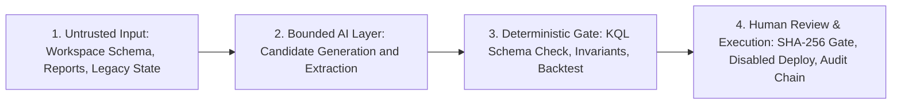

# AI Agents & Applied Engineering

[**← Back to Portfolio Index**](README.md) · [**Security Architecture →**](security-architecture.md) · [**Microsoft Sentinel →**](sentinel.md) · [**Books & Learning →**](books-and-learning.md) · [**Experience & Impact →**](experience-and-impact.md)

---

## Engineering Philosophy: Bounded AI & Deterministic Controls

When applying Large Language Models (LLMs) and AI agents to security operations or regulated workflows, optimistic prompt engineering is not an architecture. My applied AI engineering centers on **explicit architectural boundaries**:

1. **Deterministic Verification Gates:** Model outputs (such as KQL detection rules or structured clinical observations) are treated as untrusted candidate artifacts that must pass schema validation, syntax/AST verification, and invariant checks before execution.
2. **Explicit Epistemic States:** Systems distinguish between verified positive state (`satisfied` / `PASS`), verified negative state (`not-satisfied` / `FAIL`), and missing or degraded upstream telemetry (`unknown` / `DEGRADED`)—failing closed rather than guessing.
3. **Human-in-the-Loop (HITL) Governance:** High-impact actions (such as promoting a Microsoft Sentinel analytics rule or releasing a patient batch) require human approval backed by tamper-evident validation and review evidence.

---

## 1. AI-Assisted Microsoft Sentinel Detection Engineering Agent (`ai-agent-usecase-deployment` V3.4)

- **Visitor Access:** **Public case study with implementation currently private** (`86sunbot/ai-agent-usecase-deployment` V3.4 is currently private and scheduled for Stage C clean-companion release; an early V1 password-spray prototype has **public source and demo instructions** in [`86sunbot/fde-lab/tree/main/sentinel-usecase-deployment`](https://github.com/86sunbot/fde-lab/tree/main/sentinel-usecase-deployment)).

### Problem and Audience
- **Problem:** Translating threat intelligence or business detection requirements into Microsoft Sentinel analytics rules is slow and error-prone when done manually, yet deploying raw LLM-generated KQL directly to a SIEM introduces broken field references, noisy alert storms, and ungoverned configuration drift.
- **Audience:** Detection Engineers, SecOps Architects, and AI Security Engineering Teams.

### Current Capabilities (Documented in Case Study)
- **Workspace Telemetry Discovery & Grounding (`discovery.py`, `kql_sources.py`):** Queries live Log Analytics workspace schemas (or synthetic workspace snapshots) before rule generation so candidate KQL only references tables and columns verified to exist in the target environment.
- **Dual AI Provider + Offline Template Architecture (`generator.py`, `llm.py`):** Supports both live LLM generation (**OpenAI** and **Microsoft Foundry / Azure OpenAI**) and deterministic offline templates, normalizing outputs into a strict Pydantic `UseCaseArtifact` schema.
- **Deterministic KQL & Schema Validation (`validation.py`):** Inspects candidate rules for required MITRE ATT&CK tactic/technique mappings, entity mappings (`Account`, `IP`, `Host`, etc.), query window/frequency alignment, banned KQL performance anti-patterns (`search *`, unbounded joins), and schema column existence.
- **Historical Backtesting & Synthetic Telemetry (`backtest.py`, `synthetic.py`):** Evaluates candidate KQL against historical workspace telemetry or generated attack/benign synthetic events to measure expected alert volume and false-positive risk before deployment.
- **Cryptographic Readiness Gate & Safe Deployment (`readiness.py`, `deployment.py`, `terraform.py`):** Enforces a client deployment readiness gate that verifies SHA-256 digests of validation and human-review evidence artifacts before allowing ARM REST deployment or Terraform bundle export—and **always deploys rules with `enabled = false`** so human SOC operators control production activation.

### Maturity / Status
- **Working Engineering Prototype (V3.4 Specification-Driven Prototype, Locally Tested · License Selection Pending Owner Confirmation):** Python CLI (`python run.py ...`) verified locally across offline simulation, synthetic backtesting, and Microsoft Sentinel lab workflows (`test-artifacts/acceptance/2026-10-10-v3.4-lab-workflow.md`).

### Evidence and Limitations
- **Defined vs. Locally Executed Automated Tests:** **`296` automated tests defined** across 29 test files (`186` in `tests/` + `110` in `test-artifacts/`); **`295` locally executed and passed via `pytest` (`3.32s`)**, with **`1` live Azure Sentinel E2E test skipped** (`tests/test_e2e_live_sentinel.py`, gated behind `--run-live`).
- **Schema Validation vs. Live KQL Execution & Effectiveness:** Offline `validation.py` checks schema fields, table/column presence against a workspace snapshot, and static KQL anti-patterns (`search *`, missing `TimeGenerated`), while `backtest.py` replays rules against historical or synthetic fixtures. Neither offline check guarantees live Log Analytics query execution speed or production true-positive/false-positive effectiveness without staged shadow-mode tuning (`enabled = false`).
- **Documented Pattern Scan & Identifier vs. Credential Distinction:**
  - *Scan Scope:* Regex pattern scans across `HEAD` (`c8bb1c7`) and Git history detected **no authentication credentials/secrets** (no API keys, client secrets, or passwords).
  - *Non-Secret Cloud/Personal Identifiers:* 22 tracked files in `HEAD` (`generated-rules/2026-10-10-live-campaign/...`, `test-artifacts/...`, `scripts/...`, `CHANGELOG.md`) and Git history contain **non-secret personal lab identifiers** (Azure Subscription ID, Tenant ID, subscription display name, and personal Gmail address). Because `tests/test_readiness.py` verifies SHA-256 digests across those live campaign artifacts, Stage C publication will export a **clean-history public companion repository** with synthetic placeholder GUIDs (`00000000-...`) and regenerated synthetic provenance/hashes, keeping the private source repository intact.

### Canonical Source & Access Status
- **Access Status:** **Public case study with V3.4 implementation currently private** (`86sunbot/ai-agent-usecase-deployment`, prepared on local branch `portfolio/remediation-2026-10` at commit `c8bb1c7`; scheduled for clean-companion public release in Stage C).
- **Historical V1 Baseline (Public Source & Demo Instructions):** An early V1 snapshot (`2026-08-16`) has **public source and demo instructions** in [`86sunbot/fde-lab/tree/main/sentinel-usecase-deployment`](https://github.com/86sunbot/fde-lab/tree/main/sentinel-usecase-deployment).

---

## 2. Cell & Gene Therapy (CGT) Patient-to-Batch Orchestration (`FDE-Final-Capstone`)

- **Visitor Access:** **Public source and demo instructions** ([`86sunbot/FDE-Final-Capstone`](https://github.com/86sunbot/FDE-Final-Capstone)).

### Problem and Audience
- **Problem:** In autologous Cell & Gene Therapy workflows, an inherited legacy orchestration system (`source_baseline/`) suffered from silent fail-open exceptions, unverified chain-of-identity transitions, single-timestamp overwrites that erased late-arriving data history, and unauthenticated role elevation via caller-supplied headers.
- **Audience:** Forward Deployed Engineers, Systems Architects, and Engineering Hiring Managers evaluating brownfield-to-greenfield architecture and test discipline.

### Current Capabilities (Reconciled with Public `main` Code)
- **Fail-Closed State Machine & Three-State Verification (`model.py`, `application.py`):** Evaluates workflow transitions across explicit `satisfied`, `not-satisfied`, and `unknown` states—halting progression (`fail-closed`) whenever required clinical, manufacturing, cold-chain, or QA release gates are missing or stale.
- **Bitemporal State Reconciliation (`storage.py`, `patient_service.py`):** Tracks both *effective time* (when a clinical/lab event occurred) and *recorded time* (when the system ingested it), preserving historical state reconstruction when out-of-order updates arrive.
- **Tamper-Evident SHA-256 Hash-Chained Audit Log (`storage.py`):** Links every state transition and exception decision in a SQLite hash chain (`previous_hash` → `record_hash`) with automated chain-integrity verification (`verify_audit_chain()`).
- **Opaque Bearer-Token Mutation Auth & 6-Role / Scope RBAC (`api.py`, `security.py`):**
  - *Mutating API Authentication (`api.py`):* The slot-reservation endpoint (`POST /slots/reservations`) rejects caller-supplied role headers and authenticates `Authorization: Bearer <token>` via constant-time `secrets.compare_digest` against opaque server-side tokens mapped to `Principal(subject, roles, scopes)` in `FDE_DEMO_IDENTITIES_JSON` (failing closed with `HTTP 503` when unconfigured or `HTTP 401` on invalid token).
  - *Service-Layer Authorization (`security.py`):* Enforces **6 backend RBAC roles** (`ADMIN`, `COORDINATOR`, `IDENTITY_AUTHORITY`, `PLANNER`, `QUALITY_AUTHORITY`, `VIEWER`) and resource scopes (`*` or specific site/case scopes).
  - *Browser UI Lenses (`web/`):* Read-only status/source endpoints and the isolated 3-POC demo (`POST /api/demo/run`) require no mutation token and expose **7 read-only role/persona demo lenses** (Patient Operations, Identity, Logistics/Planning, Manufacturing, Lab/QC, Quality, and Executive views).

### Maturity / Status
- **Public Academic / Engineering Simulation Capstone (Locally Tested · Existing `source_baseline/LICENSE-SYNTHETIC-TRAINING.txt` Preserved; Root Application License Pending Owner Selection):** Built against a synthetic brownfield training dataset (`source_baseline/`). **Explicitly non-clinical, non-production, and not GxP-validated.**

### Evidence and Limitations
- **Defined vs. Executed Automated Tests:** **`118` automated tests defined** across 28 test files on public `main` (`eed0620`); **`118` executed and passed via `pytest`** with `96%` source coverage across `src/fde_capstone/` and `0` `ruff` errors.
- **Known Limitations (Documented in Repo):**
  - Uses deterministic rule/state evaluation (`AI_MODE=off` by default); no live LLM is in the critical safety path.
  - Of the 57 evaluation cases executed, 55 are internal structural passes, 0 failed, and 2 human-study cases are inconclusive (`7` original cases have full scoped property assertions, `9` are partial, and `39` extension cases are structural probes; `29/31` requirements internally verified, `0` production verified).
  - The SQLite audit chain is **tamper-evident** (detects unauthorized SQL mutation via SHA-256 hash verification), not hardware-immutable.
  - Contains third-party/coursework reference PDFs (`reference/FDE_PDF.pdf`, `archive/assessment-reports/*.pdf`) whose redistribution rights must be confirmed independently of any application code license.

### Canonical Source & Access Status
- **Access Status:** **Public source and demo instructions** ([**`https://github.com/86sunbot/FDE-Final-Capstone`**](https://github.com/86sunbot/FDE-Final-Capstone)).
- **Key Documentation:** [`FINAL_CAPSTONE_REPORT.md`](https://github.com/86sunbot/FDE-Final-Capstone/blob/main/docs/FINAL_CAPSTONE_REPORT.md) · [`CLIENT_DELIVERABLE_ACCEPTANCE_MATRIX.md`](https://github.com/86sunbot/FDE-Final-Capstone/blob/main/docs/CLIENT_DELIVERABLE_ACCEPTANCE_MATRIX.md) · [`Stage 2 Prototype Reuse Disposition`](https://github.com/86sunbot/FDE-Final-Capstone/blob/main/docs/stages/stage_02/05_ANTIGRAVITY_REUSE_DISPOSITION.md)

---

## 3. Clinical Monitoring Report Triage Prototype (`caldera-monitoring-triage`)

- **Visitor Access:** **Public source and demo instructions** ([`86sunbot/caldera-monitoring-triage`](https://github.com/86sunbot/caldera-monitoring-triage) · [Scoped Slice Overview](https://github.com/86sunbot/caldera-monitoring-triage#1-todays-scoped-slice-locked-at-0915) · [Sprint Walkthrough](https://github.com/86sunbot/caldera-monitoring-triage/blob/main/docs/FDE_SPRINT_STORY_AND_WALKTHROUGH.md) · [10-Minute Demo Script](https://github.com/86sunbot/caldera-monitoring-triage/blob/main/docs/DEMO_PRESENTATION_SCRIPT.md)).

### Problem and Audience
- **Problem:** Clinical trial study managers reviewing multi-page site monitoring reports face cognitive overload when manually triaging potential protocol deviations, overdue follow-up items, and site risk patterns—especially when upstream eTMF or site-registry services experience partial outages.
- **Audience:** AI Application Engineers, Regulated-Domain Product Teams, and FDE Reviewers.

### Current Capabilities (Public `main` Branch)
- **Pre-GxP Cognitive Surfacing Architecture ([`ADR-001`](https://github.com/86sunbot/caldera-monitoring-triage/blob/main/docs/governance/decisions/ADR-001-surfacing-vs-predictive.md)):** Deliberately scoped as a non-binding, human-reviewed surfacing worksheet outside the GxP system-of-record boundary (`CandidateObservation.check_forbidden_fields` rejects `score`, `risk_level`, `priority`, `severity`, `rank`, and `deviation_confirmed`).
- **Verbatim Source Attribution (`SourceCitation` in `src/models.py` & `src/pipeline/extractor.py`):** Every surfaced observation records `document_id`, `page_number`, and `verbatim_sentence` extracted from the report page text (`report.pages`), grouped by site and theme into a `SameThemeAcrossVisitsView`.
- **Three Operational Resilience Controls ("Curveballs"):**
  - *Curveball 1 (EDC & Regional Boundary):* Rejects subject-level EDC clinical fields (`enforce_edc_boundary`) and drops restricted-region reports (`SITE-404`, `RESTRICTED_REGION_X`) before extraction ([`ADR-002`](https://github.com/86sunbot/caldera-monitoring-triage/blob/main/docs/governance/decisions/ADR-002-region-restriction-boundary.md)).
  - *Curveball 2 (Registry Fail-Closed Hold):* Holds documents in staging (`ExclusionRecord`) if the Site Registry service returns HTTP 500 rather than ingesting unverified regions.
  - *Curveball 3 (Denominator Disclosure):* Degrades batch status (`DEGRADED`) and displays exact retrieved/expected report counts (`11 of 20 reports`, `3 of 6 reports`) during partial eTMF HTTP 500 outages.

### Maturity / Status
- **Public FDE Sprint Prototype (Dual Python + TypeScript/React Implementation · License Selection Pending):** Interactive web prototype (`npm run dev` via `tsx server.ts` and `src/App.tsx`) and Python pipeline (`src/pipeline/triage_graph.py`) operating over 20 synthetic monitoring reports (`data/sample_reports/twenty_reports.json`).

### Evidence and Limitations
- **Public `main` Automated Tests (`eeac9b9`):**
  - **Python Automated Tests (`9` defined in `tests/` / `9` executed and passed via `pytest tests/ -v --tb=short`):** Covers regional restriction gating, EDC boundary enforcement, forbidden-score rejection, verbatim sentence/page provenance, Google AI Studio unconfigured fallback, 20-report end-to-end slice execution, and HTTP 500 eTMF / Site Registry degradation in `.github/workflows/ci.yml`.
  - **TypeScript Web Application (`package.json`):** Provides `npm run dev` (`tsx server.ts`), `npm run lint` (`tsc --noEmit`), and `npm run build` (`vite build` + `esbuild server.ts`).
- **Known Limitations on Public `main`:**
  - **Not a GxP-validated system:** Per [`ADR-001`](https://github.com/86sunbot/caldera-monitoring-triage/blob/main/docs/governance/decisions/ADR-001-surfacing-vs-predictive.md), the prototype sits *outside* 21 CFR Part 11 / GxP validation as an unrecorded cognitive aid.
  - **Placeholder CLI reference in public docs:** `README.md` (`#3-repository-architecture`) and `docs/google_ai_studio_setup.md` on public `main` mention `src/main.py`, which is not present in `src/`; the public repository runs via `npm run dev` (web server) or `pytest tests/ -v --tb=short` (Python pipeline test suite).
  - **In-memory execution:** Outputs are returned in-memory rather than persisted to WORM storage. *(Additional negative citation-substring checks and TypeScript CI steps have been prepared locally on an unpushed branch and are not yet published to `main`).*

### Canonical Source & Access Status
- **Access Status:** **Public source and demo instructions** ([**`https://github.com/86sunbot/caldera-monitoring-triage`**](https://github.com/86sunbot/caldera-monitoring-triage) · [Sprint Walkthrough](https://github.com/86sunbot/caldera-monitoring-triage/blob/main/docs/FDE_SPRINT_STORY_AND_WALKTHROUGH.md) · [10-Minute Demo Script](https://github.com/86sunbot/caldera-monitoring-triage/blob/main/docs/DEMO_PRESENTATION_SCRIPT.md) · [`docs/governance/risk-register.md`](https://github.com/86sunbot/caldera-monitoring-triage/blob/main/docs/governance/risk-register.md)).

---

## 4. AI Security Lab (`ai-security-lab`)

- **Visitor Access:** **Public case study with implementation currently private** (`86sunbot/ai-security-lab` is currently private and scheduled for Stage C public release).

### Problem and Audience
- **Problem:** Enterprise teams adopting LLMs and Retrieval-Augmented Generation (RAG) on Azure frequently overlook indirect prompt injection via retrieved documents, cross-tenant vector-index leakage, and excessive tool-execution permissions.
- **Audience:** AI Security Architects, Red Teamers, and Cloud Security Engineers securing Azure OpenAI / Microsoft Foundry workloads.

### Current Capabilities (Documented in Case Study)
- **LLM Application Threat Model (`threat-models/llm-threat-model.md`):** End-to-end decomposition of an enterprise LLM application across 5 trust boundaries using **STRIDE**, **OWASP Top 10 for LLM Applications**, and **MITRE ATLAS**, complete with risk scoring and control mappings.
- **Prompt Injection Attack Taxonomy & Defenses (`prompt-injection/attack-taxonomy.md`):** Classification of direct vs. indirect prompt injection, Crescendo multi-turn escalation, payload splitting, encoding bypasses, and multi-layer defenses (Azure AI Content Safety Prompt Shields, spotlighting/datamarking, output schema validation, and least-privilege tool gates).
- **Secure RAG Pipeline Architecture (`rag-security/rag-pipeline-security.md`):** Reference architecture for enterprise RAG on Azure covering document ingestion sanitization, Purview sensitivity-label inheritance, Azure AI Search document-level ACL security trimming, Private Link network isolation, and output grounding checks.

### Maturity / Status
- **Reference Architecture & Threat-Modeling Documentation (Existing Root `MIT` License Preserved):** Technical documentation repository (3 architecture documents).

### Evidence and Limitations
- **Validation Scope & Documented Pattern Scan:** No automated test suite is defined in this documentation repository; embedded Python snippets were syntax-checked via `ast.parse`, and regex pattern scans across `HEAD` and Git history detected no credentials or personal Azure GUIDs.
- **Known Limitations:** Documentation and reference patterns only; for an executable RAG implementation with public source and automated tests, see `fde-lab/document-assistant/versions/v3-enterprise-assistant`.

### Canonical Source & Access Status
- **Access Status:** **Public case study with implementation currently private** (`86sunbot/ai-security-lab`, prepared on local branch `portfolio/remediation-2026-10` at commit `d9a4f2a` — Stage C candidate).

---

## 5. Forward Deployed Engineering Lab & AI/DR Architecture Comparison (`fde-lab`)

- **Visitor Access:** **Public source and demo instructions** ([`86sunbot/fde-lab`](https://github.com/86sunbot/fde-lab)).

### Problem and Audience
- **Problem:** Practitioners need concrete comparisons of enterprise AI/Detection & Response platforms and progressive examples showing how a simple retrieval prototype evolves into a tested service with explicit API contracts.
- **Audience:** Security Architects, FDE Practitioners, and Applied AI Engineers.

### Current Capabilities (Public `main` Branch)
- **Enterprise AI/DR Architecture Comparison ([`microsoft_vs_crowdstrike_ai_dr_guide.md`](https://github.com/86sunbot/fde-lab/blob/main/microsoft_vs_crowdstrike_ai_dr_guide.md)):** 491-line comparative analysis of **Microsoft Defender XDR + Sentinel + Security Copilot** vs. **CrowdStrike Falcon + Charlotte AI**, evaluating telemetry architecture, SIEM data-lake economics, identity protection (MDI vs. Falcon Identity), cloud security (Defender for Cloud vs. Falcon Cloud Security), and agentic SOC workflows.
- **Document Assistant Progression ([`document-assistant/versions/`](https://github.com/86sunbot/fde-lab/tree/main/document-assistant/versions)):**
  - `v1-retrieval`: Local TF-IDF baseline over PDF chunks.
  - `v2-ai-assistant`: OpenAI RAG integration with C4 architecture diagrams and ADRs (`ADR-001`..`ADR-004`).
  - [`v3-enterprise-assistant`](https://github.com/86sunbot/fde-lab/tree/main/document-assistant/versions/v3-enterprise-assistant): Decoupled FastAPI backend (`app/`) + Streamlit frontend (`frontend/`), local vector snapshot, Docker Compose setup (`docker compose up --build`), evaluation harness (`evals/cases.json`), and **32 automated tests** across 9 test files run via `python3 -m pytest`.
- **Sentinel Use-Case Deployment V1 Baseline ([`sentinel-usecase-deployment/`](https://github.com/86sunbot/fde-lab/tree/main/sentinel-usecase-deployment)):** Historical V1 snapshot (`2026-08-16`) of the password-spray KQL generator (`python run.py create "Create a password spray detection" --offline-reference`) with **28 automated tests** across 5 test files run via `pytest` (subsequently expanded into the standalone V3.4 repository [`ai-agent-usecase-deployment`](#1-ai-assisted-microsoft-sentinel-detection-engineering-agent-ai-agent-usecase-deployment-v34)).

### Maturity / Status
- **Public Multi-Project Engineering Lab & Architecture Comparison Repository (Locally Tested · License Selection Pending Owner Confirmation):** Publicly accessible on GitHub.

### Evidence and Limitations
- **Defined vs. Executed Automated Tests:** **`60` automated tests are defined on public `main` (`6d1566a`) and pass locally via `pytest` (`60 passed`)** across the two test suites (**`32 passed`** + `ruff check .` in `document-assistant/versions/v3-enterprise-assistant/`, which is wired into `.github/workflows/v3-ci.yml` on public `main`, and **`28 passed`** + `ruff check .` in `sentinel-usecase-deployment/`, with a dual-component CI workflow prepared on a local unpushed branch). Note that `v1-retrieval` and `v2-ai-assistant` are earlier stage snapshots without standalone CI test suites.
- **Third-Party Test Fixture & Redistribution Note:** The sample PDF in `fde-lab` (`document.pdf` inside `document-assistant/versions/v2-ai-assistant/` and `v3-enterprise-assistant/`, and `Microsoft Defender for Identity _ Microsoft Learn.pdf` at the repo root on public `main`) is a 4-page print-to-PDF of Microsoft Learn documentation (*"Microsoft Defender for Identity Overview"*). Excluding `document.pdf` from an `MIT` code license does **not** by itself establish a right to redistribute Microsoft documentation; replacing `document.pdf` with a self-authored synthetic PDF fixture (or confirming Microsoft Learn CC/redistribution terms) is recommended before applying a final repository license.

### Canonical Source & Access Status
- **Access Status:** **Public source and demo instructions** ([**`https://github.com/86sunbot/fde-lab`**](https://github.com/86sunbot/fde-lab)).
- **Architecture Comparison Direct Link:** [**`Enterprise AI/DR: Microsoft Security vs. CrowdStrike Falcon`**](https://github.com/86sunbot/fde-lab/blob/main/microsoft_vs_crowdstrike_ai_dr_guide.md)
