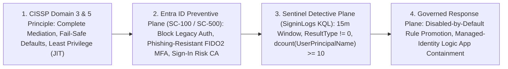

# Books, Study Guides & Technical Learning

[**← Back to Portfolio Index**](README.md) · [**Security Architecture →**](security-architecture.md) · [**Microsoft Sentinel →**](sentinel.md) · [**AI Agents →**](ai-agents.md) · [**Experience & Impact →**](experience-and-impact.md)

---

## Authorship Overview

Writing comprehensive architecture guides and certification handbooks is how I codify engineering standards and test my own command of security protocols, Azure control planes, and AI governance.

All books below are **independently authored, unpublished local digital manuscripts and study guides (PDF + Markdown/Typst/Python source)** compiled in 2026. They are **not commercially published or ISBN-registered**, and **none are affiliated with, sponsored by, or endorsed by Microsoft or ISC2**.

> **Publication Scope & Rights Notice:**
> - **Authorship & Non-Affiliation:** Independently authored educational reference guides. Exam codes (`SC-100`, `SC-500`, `CISSP`, `AI-901`) reference publicly published syllabus objectives.
> - **Preview Assets Excluded in Stage A:** Book cover, table-of-contents, and mindmap preview images are excluded from the Stage A public repository and commit history pending explicit owner approval.
> - **Licensing:** Existing repository licenses (such as `MIT` in `cissp-knowledge-base`) are preserved; new licensing choices for `portfolio` and unpublished book companion materials remain pending explicit owner selection.

| Title | Edition & Date | Exam / Curriculum Baseline | Scope & Length | Visitor Access & Publication Status |
| :--- | :--- | :--- | :--- | :--- |
| ***Microsoft Security Architect Master Blueprint*** | **Surya Edition v1.1** (October 2026) | `SC-100`, `SC-500`, `SC-200`, `SC-300`, `SC-401` · Oct 2026 SFI & Unified SecOps Baseline | **958 pages** (12 chapters, 10 appendices, 150 diagrams, 109 ADRs, 6 labs) | **Public case study & chapter outline (manuscript currently private):** Unpublished local v1.1 PDF + 34 Markdown source files (Stage C companion candidate). |
| ***Microsoft SC-500: Cloud and AI Security Engineer — Complete Study Guide + Implementation Handbook*** | **Surya Edition v1.1 FINAL** (October 2026) | Microsoft Exam `SC-500` (`SC-500T00-A`), May–July 2026 Study Guide (87/87 sub-objectives) | **434 pages** (11 parts, 26 technical + 4 revision chapters, 27 diagrams, 28 labs) | **Public case study & chapter outline (manuscript currently private):** Unpublished local v1.1 A4 Typst PDF + 13,331-line Markdown/Typst source. |
| ***Surya Master CISSP Guide*** & ***Eight-Domain Mindmaps*** | **First Consolidated Edition** (October 2026) | Official ISC2 CISSP Exam Outline effective **April 15, 2024** (All 8 Domains) | **382 pages** (`121,547` words, 62 objectives, 500 concept cards) + **9-page** Mindmap Pack | **Public case study & domain outline (manuscript and `cissp-knowledge-base` repo currently private):** Local A4 PDF + Stage C companion repository. |
| ***Microsoft Azure AI Fundamentals (AI-901) — Complete 6-Day All-in-One Master Study Guide*** | **Master Study Edition** (October 2026) + **Concise Review Aid** (August 2026) | Microsoft Exam `AI-901` (2026 Microsoft Foundry & Foundry Tools syllabus) | **38 pages** (7 concept groups + 2-page cheat sheet) & **9-page** Original Review Guide | **Public case study & syllabus outline (manuscripts currently private):** Local PDF + Markdown/HTML study pack. |

---

## Publicly Inspectable Sample Lesson: Cross-Domain Architecture Walk-Through (CISSP → Entra ID `SC-100`/`SC-500` → Microsoft Sentinel)

> **Originality & Manuscript Separation Notice:** This cross-domain lesson was written specifically for the public GitHub portfolio (`86sunbot/portfolio`) to demonstrate my teaching and architectural synthesis style using the publicly inspectable [`fde-lab/sentinel-usecase-deployment`](https://github.com/86sunbot/fde-lab/tree/main/sentinel-usecase-deployment) codebase. It is **100% original portfolio content** and is **completely separate from the four unpublished local book manuscripts** listed above (no chapters, text, or figures from the unpublished manuscripts are reproduced here).

### Scenario: Defending and Detecting Single-IP Password Spraying Against Cloud Identity

### Cross-Domain Control & Verification Matrix

| Architectural Layer | CISSP Principle (Domains 3, 5 & 7) | Azure / Entra ID Control Plane (`SC-100` / `SC-500`) | Microsoft Sentinel Verification & Public Artifact |
| :--- | :--- | :--- | :--- |
| **1. Boundary Mediation** | **Complete Mediation (Domain 3):** Every access request must be checked against an authority; no protocol bypass paths allowed. | **Conditional Access — Block Legacy Authentication:** Reject protocols (`POP`, `IMAP`, `SMTP`, basic auth) that cannot enforce MFA or device posture. | Query `SigninLogs \| where ClientAppUsed !in ("Browser", "Mobile Apps and Desktop clients")` to verify zero legacy-auth successes after policy enforcement. |
| **2. Authentication Assurance** | **Defense in Depth & Fail-Safe Defaults (Domains 3 & 5):** Assume single-factor secrets will be sprayed or phished; require cryptographic possession for Tier-0 roles. | **Authentication Strengths + Smart Lockout:** Enforce **Phishing-Resistant MFA (`FIDO2` / `Windows Hello for Business`)** for privileged personas and configure Entra Smart Lockout thresholds. | Inspect `AuthenticationRequirement` and `ResultType` (`50126` invalid password, `50053` smart lockout) in `SigninLogs` across targeted accounts. |
| **3. Detection Engineering** | **Intrusion Detection & Signal-to-Noise Discipline (Domain 7):** Aggregate low-and-slow failures across distinct principals rather than alerting on single user typos. | **AMA / Diagnostic Settings (`SigninLogs` & `AADNonInteractiveUserSignInLogs`):** Stream interactive and non-interactive sign-in telemetry into the Sentinel Log Analytics workspace. | **Publicly Inspectable KQL Rule:** Summarize `ResultType != "0"` over `DetectionWindow = 15m` by `SourceIP = IPAddress, bin(TimeGenerated, DetectionWindow)` where `dcount(UserPrincipalName) >= 10` and `count() >= 20` ([`reference_proposer.py`](https://github.com/86sunbot/fde-lab/blob/main/sentinel-usecase-deployment/src/sentinel_usecase/agent/reference_proposer.py)). |
| **4. Change & Response Governance** | **Separation of Duties (Domains 1 & 7):** Neither an automated rule generator nor a single unreviewed change should alter production enforcement without verification. | **Entra ID PIM + System-Assigned Managed Identity:** Use JIT role activation for human approvers and secretless Managed Identities for SOAR containment playbooks. | **Publicly Inspectable Validator & Gateway:** Enforce `enabled = False` and `ApprovalDecision.APPROVE` in [`structural.py`](https://github.com/86sunbot/fde-lab/blob/main/sentinel-usecase-deployment/src/sentinel_usecase/validation/structural.py), [`workflow.py`](https://github.com/86sunbot/fde-lab/blob/main/sentinel-usecase-deployment/src/sentinel_usecase/workflow.py), and [`gateway.py`](https://github.com/86sunbot/fde-lab/blob/main/sentinel-usecase-deployment/src/sentinel_usecase/deployment/gateway.py). |

### Architecture Review Board (ARB) Defense Takeaway
- **Exam & Practitioner Trap (`CISSP` / `SC-100`):** Relying solely on per-user account lockout (`50053`) against a low-and-slow password spray (1 failed attempt per user across 200 users from a single IP) either misses the attack (if threshold > 1) or enables mass denial-of-service against legitimate users (if threshold is too aggressive). Combining **Entra ID Conditional Access + Phishing-Resistant MFA** (preventive control) with **cross-principal `dcount(UserPrincipalName)` aggregation in Sentinel `SigninLogs`** (detective control) addresses both confidentiality and availability.

---

## 1. *Microsoft Security Architect Master Study Guide & Reference Architecture (v1.1)*

- **Visitor Access:** **Public chapter and template summary with manuscript currently private.**

### Verified Publication Metadata
- **Exact Title:** *Microsoft Security Architect Master Study Guide & Reference Architecture* (PDF metadata title: *Microsoft Security Architect Master Blueprint — Surya Edition v1.1*)
- **Subtitle:** *Zero-Baseline to Principal Security Architect (`L0 → L5`) Across Identity, Governance, Network, Application, Data, Cloud Workload, Unified SecOps, Exposure Management, AI Security, and Enterprise Architecture Discipline*
- **Edition & Date:** **Surya Edition v1.1 — October 2026 Master Architecture Baseline** (plus earlier 175-page *Compact Technical Field Manual* edition, Oct 5, 2026)
- **Publication Status:** Unpublished self-authored digital reference manuscript (`Surya_Microsoft_Security_Architect_Master_Blueprint_v1.1.pdf`, **958 pages**, `35.04 MB`, `P0=0 / P1=0` local QA check) with 34 modular Markdown files, 7 phase study guides, 6 integrated lab runbooks, and reusable HLD/ADR templates.
- **Curriculum & Objective Baseline:** October 2026 Microsoft Security ecosystem—incorporating the **Microsoft Secure Future Initiative (SFI)**, **Unified Security Operations in the Microsoft Defender Portal (`security.microsoft.com`)** ahead of the March 31, 2027 Azure Portal Sentinel retirement, **CAF Workload Landing Zones**, **MCSB v2 AI Security Domain**, **Microsoft Entra Agent ID**, and **Purview Unified DSPM for AI**. Mapped across **`SC-100`** (Cybersecurity Architect Expert), **`SC-500`**, **`SC-200`**, **`SC-300`**, and **`SC-401`** (explicitly accounting for the August 31, 2026 retirement of `AZ-500`).

### Structure & Contents (Documented in Summary)
- **12 Technical Chapters (`publication/`):** Each chapter follows a uniform 27-section architectural rubric covering protocol mechanics, Azure control-plane enforcement, failure modes, trade-off tables, KQL/Bicep/CLI implementation patterns, and `L1–L5` Architecture Review Board (ARB) defense questions:
  1. *Foundations, Protocol Mechanics & Cryptographic Trust* (Subnetting, Split-Horizon DNS, TLS/mTLS, Kerberos, SAML 2.0, OAuth 2.0 / OIDC JWTs, Zero Trust & STRIDE)
  2. *Azure Governance, Management Groups, Policy & CAF Landing Zones*
  3. *Microsoft Entra ID, Conditional Access, Phishing-Resistant MFA, PIM & Global Secure Access (SSE)*
  4. *Hybrid Network Security, Hub-Spoke vs. vWAN, Azure Firewall Premium, WAF & Private Link DNS*
  5. *Application Security, API Management (APIM) JWT Gateways, Key Vault Managed HSM & SFI Pillar 4 DevSecOps*
  6. *Data Security, Microsoft Purview MIP Labels, Encryption Hierarchy (MMK/CMK/DKE), DLP & Insider Risk*
  7. *Cloud-Native Application Protection (Defender for Cloud CSPM/CWPP), Attack Path Analysis & Multicloud (AWS/GCP/Arc)*
  8. *Unified Security Operations (Defender XDR + Microsoft Sentinel), AMA/DCR Transformations & Log Tier FinOps*
  9. *Detection Engineering, KQL Optimization, ASIM Normalization & Managed-Identity SOAR*
  10. *Microsoft Security Exposure Management (MSEM), Attack Surface Reduction & Vulnerability Governance*
  11. *AI & Agentic Security: M365 Copilot Governance, Zero Trust RAG (Azure AI Foundry + AI Search ACL Trimming + Content Safety Prompt Shields) & Microsoft Entra Agent ID*
  12. *Principal Security Architecture Leadership, HLD/LLD Authoring, ADR Governance & Executive Risk Advisory*
- **10 Comprehensive Appendices (`Appendices A–J`):**
  - `162` `L0–L5` competency gates, `15` reusable HLD/ADR templates, `109` Architecture Decision Records, `246` curated Microsoft Learn reference mappings, and `22` industry framework alignments.
- **Companion Labs & Templates:**
  - *Contoso-ZeroTrust Integrated Lab Runbook* (Labs 1–6)
  - *20-Section Enterprise HLD Template* & *ADR Exemplar*

### Evidence, Limitations & Access
- **Evidence:** Complete 34-file Markdown publication pack (`publication/`), 7-phase study system (`phases/`), lab runbook (`labs/`), and compiled 958-page PDF verified locally.
- **Limitations:** Independent educational and reference work; lab exercises require a non-production Azure/Entra tenant with appropriate trial or lab licenses.
- **Access Status:** **Public chapter and template summary with manuscript currently private.**

---

## 2. *Microsoft SC-500: Cloud and AI Security Engineer — Complete Study Guide (v1.1)*

- **Visitor Access:** **Public chapter and lab outline with manuscript currently private.**

### Verified Publication Metadata
- **Exact Title:** *Microsoft SC-500: Cloud and AI Security Engineer — Complete Study Guide + Implementation Handbook (Surya Edition v1.1)*
- **Series:** *Surya Technical Architecture Series · Edition 1.1*
- **Edition & Date:** **v1.1 FINAL (`FROZEN`) — October 7, 2026**
- **Publication Status:** Unpublished self-authored digital manuscript (**434 pages**, local A4 PDF compiled via Typst from `SC-500_Complete_Study_Guide_Surya_v1.1.md` [13,331 lines] and modular Typst source files `src/part0_foundations.typ` .. `src/part10_revision.typ`).
- **Exam Objective Version:** Aligned to Microsoft Exam **`SC-500`** (*Microsoft Certified: Cloud and AI Security Engineer Associate*, Course `SC-500T00-A`), reflecting the official Microsoft Learn Study Guide revision (**May–July 2026**). Maps **100% of all 87 official exam sub-objectives** across all 4 domains:
  - *Domain 1:* Secure Identity, Access, and Governance (20–25%)
  - *Domain 2:* Secure Storage, Databases, and Networking (25–30%)
  - *Domain 3:* Secure Compute and AI Workloads (20–25%)
  - *Domain 4:* Manage and Monitor Security Posture and Microsoft Security Copilot (20–25%)

### Structure & Contents (Documented in Summary)
- **11 Parts (`Part 00` – `Part 10`) & 4 Appendices (`Appendices A–D`):**
  - **26 Technical Chapters** covering foundational protocols, Entra ID & workload identities, Azure Policy/RBAC/locks, network micro-segmentation & Private Link, storage/database encryption & Defender plans, compute/AKS/container hardening, Azure AI Foundry & Content Safety security, Defender for Cloud CSPM/CWPP, Microsoft Sentinel DCRs/analytics, and Microsoft Security Copilot governance.
  - **4 Dedicated Exam Revision Chapters (`Part 10`):**
    - *Chapter 27:* 12 Master Architectural Decision Tables
    - *Chapter 28:* 16 End-to-End Multi-Service Enterprise Scenarios
    - *Chapter 29:* Top 25 SC-500 Exam Traps & Boundary Distinctions
    - *Chapter 30:* 8 Domain Final Revision Sheets
  - **27 Vector Architecture Diagrams** (`Diagram 0.1` to `Diagram 9.1`).
  - **28 Standardized 10-Stage Hands-On Labs** (`Lab 1.1` to `Lab 9.1`), each following: *Scenario → Requirement → Architecture → Build → Secure → Validate → Break → Observe → Fix → Clean Up*.
- **Companion Verification & Study Artifacts (Local Manuscript Pack):**
  - `SC-500_Coverage_Matrix.md` (87/87 sub-objective traceability matrix)
  - `SC-500_Lab_Index.md` & `SC-500_Lab_Priority_Matrix.md`
  - `SC-500_v1.1_Technical_Validation_Report.md` & `SC-500_v1.1_Visual_QA_Report.md`
- **Access Status:** **Public chapter and lab outline with manuscript and cover/TOC previews currently private pending owner approval.**

---

## 3. *Surya Master CISSP Guide*, *Eight-Domain Mindmaps* & *CISSP Knowledge Base*

- **Visitor Access:** **Public domain outline with manuscript and `cissp-knowledge-base` repository currently private** (`86sunbot/cissp-knowledge-base` is scheduled for Stage C public release).

### Verified Publication Metadata
- **Exact Title:** *Surya Master CISSP Guide* (accompanied by *Surya CISSP Eight-Domain Mindmaps* and the `cissp-knowledge-base` repository)
- **Credential Context:** ISC2 Verified CISSP Credential issued Jan 16, 2026
- **Edition & Date:** **First Consolidated Edition — October 2026** (Unpublished self-authored local A4 PDF manuscript + Python ReportLab source package)
- **Exam Objective Version:** Official **ISC2 CISSP Exam Outline effective April 15, 2024** across all 8 domains:
  1. Security and Risk Management (16%)
  2. Asset Security (10%)
  3. Security Architecture and Engineering (13%)
  4. Communication and Network Security (13%)
  5. Identity and Access Management (IAM) (13%)
  6. Security Assessment and Testing (12%)
  7. Security Operations (13%)
  8. Software Development Security (10%)

### Structure & Contents (Documented in Summary)
1. ***Surya Master CISSP Guide* (`Surya-Master-CISSP-Guide.pdf` — Local Manuscript):**
   - **382 pages** (`121,547` words), unifying all 8 individual *CISSP Domain 1–8 Surya Master Overview* monographs into a single continuous reference.
   - **62 numbered ISC2 exam objectives** and **112 domain consolidation sections** (14 structured sections per domain).
   - **500 seven-field concept cards** (`3,500` structured field entries covering definition, architectural purpose, failure mode, exam trap, control pairing, and executive takeaway).
   - **8 Final Domain Decision Frameworks**, an **8-page cross-domain Final Revision chapter**, **146 unified glossary entries**, an **Alphabetical Concept Finder**, **430 source coverage mappings**, and **92 bibliography references** (`722` PDF bookmarks, `1,798` internal links, `0` broken links).
2. ***Surya CISSP Eight-Domain Mindmaps* (`Surya-CISSP-Eight-Domain-Mindmaps.pdf` — Local Manuscript):**
   - **9-page** visual synthesis pack mapping the hierarchical relationships across all 8 CISSP domains (preview image held pending owner approval).
3. **Companion Repository — `86sunbot/cissp-knowledge-base` (Currently Private):**
   - Maps theoretical CISSP frameworks across all 8 domains directly to concrete **Azure, Microsoft Entra ID, Defender XDR, Purview, and Sentinel controls**:
     - `domain-1-security-and-risk-management/risk-management-framework.md`: Quantitative (ALE/SLE/ARO) vs. qualitative risk analysis, NIST RMF, ISO 27001, and cloud shared-responsibility governance.
     - `domain-2-asset-security/data-classification.md`: Data lifecycle security, Purview sensitivity labeling, cryptographic erasure, and privacy alignment.
     - `domain-3-security-architecture/security-models-and-frameworks.md`: Bell-LaPadula, Biba, Clark-Wilson, Brewer-Nash, Zero Trust, and SABSA/TOGAF mapping.
     - `domain-4-communication-network-security/network-security-fundamentals.md`: OSI/TCP-IP security, TLS 1.3, IPsec IKEv2, micro-segmentation, and ZTNA.
     - `domain-5-identity-access-management/privileged-access-management.md`: SAML/OIDC federation, FIDO2/WebAuthn, Entra PIM JIT access, and RBAC/ABAC policy models.
     - `domain-6-security-assessment-testing/security-assessment-testing.md`: Vulnerability management, penetration testing methodology, SOC 2 Type II / ISO audit evidence, and continuous posture validation.
     - `domain-7-security-operations/incident-response.md`: NIST SP 800-61r2 incident lifecycle, digital forensics chain of custody, SOAR playbooks, and DRP/BCP metrics (RTO/RPO/WRT/MTD).
     - `domain-8-software-development-security/secure-sdlc.md`: Threat modeling (STRIDE/DREAD), SAST/DAST/SCA/IAST pipeline gates, SBOM supply-chain integrity, and OWASP Top 10 controls.

### Evidence, Limitations & Access
- **Evidence:** Verified active [**ISC2 CISSP badge**](https://www.credly.com/badges/5c478c9e-77f0-4227-9251-69ecb1d639e5); automated PDF QA report (`0` broken links across `2,273` internal/external links); 8 complete domain guides in `cissp-knowledge-base` (existing root `MIT` license preserved).
- **Limitations:** Contains zero proprietary ISC2 exam questions; all examples and concept cards are original educational material.
- **Access Status:** **Public case study and domain outline with manuscript and `86sunbot/cissp-knowledge-base` repository currently private** (prepared on branch `portfolio/remediation-2026-10` — Stage C candidate).

---

## 4. *Microsoft Azure AI Fundamentals (AI-901)* Study Guides

- **Visitor Access:** **Public syllabus summary with manuscripts currently private.**

### Verified Publication Metadata
- **Titles & Editions:**
  1. ***Microsoft Azure AI Fundamentals (AI-901) — The Complete 6-Day All-in-One Master Study Guide*** (October 4, 2026 · **38 pages**, `3.05 MB` PDF + 1,079-line Markdown/HTML source + companion interactive quiz and mindmaps).
  2. ***AI-901 Study Guide: A Clean, Original Review Guide for Microsoft Azure AI Fundamentals*** (August 31, 2026 · **9 pages**, concise original review aid).
- **Exam Objective Version:** Updated **2026 Microsoft Exam `AI-901`** syllabus covering **Microsoft Foundry** (formerly Azure AI Studio) and **Foundry Tools** (Azure AI Services):
  - *Domain 1 (25–30%):* AI Workloads, Machine Learning Fundamentals & Responsible AI Principles (Fairness, Reliability & Safety, Privacy & Security, Inclusiveness, Transparency, Accountability)
  - *Domain 2 (30–35%):* Generative AI, Microsoft Foundry Platform & AI Agents (`AIProjectClient`, Responses API `client.responses.create`, Model Context Protocol [MCP] servers, `tool_choice`, Content Safety Prompt Shields)
  - *Domain 3 (35–40%):* Natural Language Processing, Speech (`Voice Live API`), Computer Vision (`gpt-image-1`), and Information Extraction (`Azure Content Understanding` async polling `begin_analyze` / `poller.result()`)

### Evidence & Limitations
- **Evidence:** Complete 38-page PDF and 9-page concise review PDF with architectural comparison matrices and Python SDK reference snippets; includes documented corrections for 25+ third-party practice-bank answer-key errors.
- **Limitations:** Unofficial independent study aids prepared for AI-901 exam mastery.
- **Access Status:** **Public syllabus summary with manuscripts currently private.**

---

## 5. Selected Public Articles & Architecture Comparisons (Publicly Accessible Now)

- **[How NOT to Design Microsoft Sentinel](https://www.linkedin.com/feed/update/urn:li:activity:7434462569752571904/)** *(Public LinkedIn Article)* — Architectural breakdown of common enterprise SIEM anti-patterns (unbounded ingestion before use-case mapping, missing DCR transformation filtering, unvalidated connector health, and alert-fatigue rules) and how to correct them.
- **[Enterprise AI/DR Architecture Comparison: Microsoft Security vs. CrowdStrike Falcon](https://github.com/86sunbot/fde-lab/blob/main/microsoft_vs_crowdstrike_ai_dr_guide.md)** *(Public Source in `fde-lab`)* — Comparative analysis of telemetry architecture, SIEM data-lake economics, identity protection, and AI-assisted SecOps across Microsoft Defender XDR + Sentinel and CrowdStrike Falcon.
- **[CISSP Domain 1 Executive Conclusion](https://www.linkedin.com/feed/update/urn:li:activity:7465372048421281793/)** & **Domain 3 Secure Design Principles Briefings** *(Public LinkedIn Series)* — Practitioner synthesis connecting security governance and secure design principles (least privilege, fail-safe defaults, economy of mechanism, complete mediation) to cloud architecture decisions.
