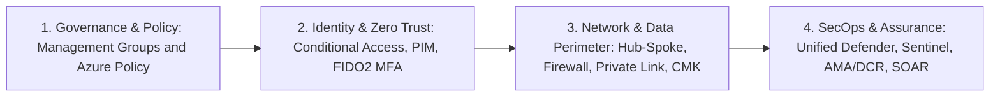

# Security Architecture

[**← Back to Portfolio Index**](README.md) · [**Microsoft Sentinel →**](sentinel.md) · [**AI Agents →**](ai-agents.md) · [**Books & Learning →**](books-and-learning.md) · [**Experience & Impact →**](experience-and-impact.md)

---

## Architectural Philosophy & Domain Scope

My security architecture work translates business risk, regulatory obligations, and infrastructure constraints into **Azure Cloud Adoption Framework (CAF) landing zones**, **Zero Trust identity and network boundaries**, **data encryption hierarchies**, and **governed security operations**.

Rather than treating security controls as isolated checklists, every design connects four layers:

---

## 1. Azure Security Architecture Framework (`azure-security-framework`)

- **Visitor Access:** **Public case study with implementation currently private** (`86sunbot/azure-security-framework` is currently private and scheduled for Stage B public release).

### Problem and Audience
- **Problem:** Enterprise cloud teams frequently deploy Azure workloads before establishing consistent management-group policy inheritance, Conditional Access persona separation, private-link DNS resolution, or encryption key-management boundaries.
- **Audience:** Cloud Security Architects, Azure Platform Engineers, Security Assessors, and CISOs designing or reviewing Azure landing zones.

### Current Capabilities (Documented in Case Study)
- **Identity (`identity/conditional-access-policies.md`):** Persona-based Conditional Access design matrix covering administrators, standard users, guest/external identities, workload identities, break-glass exclusions, session controls, and phased `Report-only` → `On` rollout.
- **Network (`network/hub-spoke-architecture.md`):** Hub-and-spoke reference topology integrating Azure Firewall inspection, Bastion administrative access, Application Gateway WAF ingress, NSG micro-segmentation, and Private Endpoint / Private DNS integration.
- **Data Protection (`data-protection/encryption-at-rest.md`):** Comparative architecture and Bicep patterns for Platform-Managed Keys (PMK), Customer-Managed Keys (CMK) in Azure Key Vault / Managed HSM, Customer-Provided Keys (CPK), Azure Disk Encryption vs. Encryption at Host, and TDE for SQL workloads.
- **Compliance & Policy (`compliance/azure-policy-library.md`):** Management Group policy assignment strategy using `Audit`, `Deny`, `DeployIfNotExists` (DINE), and `Modify` effects aligned to Microsoft's MCSB control baseline.
- **DevSecOps (`devsecops/pipeline-security.md`):** Supply-chain and CI/CD pipeline security controls covering secret scanning, SAST, SCA, IaC policy gates (`Checkov`/`TFSec`), container image signing, and workload identity federation (OIDC).
- **Security Monitoring (`monitoring/sentinel-workspace-design.md`):** Single- vs. multi-workspace Microsoft Sentinel architecture, retention tiering, RBAC operating models, and Azure Lighthouse cross-tenant management.

### Maturity / Status
- **Reference Architecture Documentation (Active, v1.1 Remediated · Existing Root `MIT` License Preserved):** Structured Markdown reference guides with embedded Bicep, JSON policy definitions, KQL queries, and architecture diagrams.

### Evidence and Limitations
- **Validation Scope & Documented Pattern Scan:** 6 domain architecture documents mapped to Microsoft's MCSB control baseline, Azure CAF, and NIST SP 800-53 / CIS Controls. No automated runtime test suite is defined; embedded JSON/Bicep/KQL snippets and internal links were inspected statically, and regex pattern scans across `HEAD` (`b4dc780`) and Git history detected no authentication credentials or personal Azure GUIDs (only RFC 4122 zero/example GUIDs `00000000-...` / `11111111-...` and `contoso.com` domains).
- **Known Limitations:**
  - This repository provides reference patterns, decision matrices, and template snippets rather than an automated end-to-end Terraform/Bicep deployment module (for executable Sentinel deployment automation, see [`Sentinel-as-a-Service`](sentinel.md#2-sentinel-as-a-service--greenfield-deployment-kit--orchestrator-sentinel-as-a-service)).
  - Additional planned deep-dive modules (such as standalone PIM and Defender for Cloud CSPM guides) are consolidated in the companion [*Microsoft Security Architect Master Blueprint v1.1*](books-and-learning.md#1-microsoft-security-architect-master-study-guide--reference-architecture-v11).

### Canonical Source & Access Status
- **Access Status:** **Public case study with implementation currently private** (`86sunbot/azure-security-framework`, prepared on local branch `portfolio/remediation-2026-10` at commit `b4dc780` — Stage B candidate).
- **Related Books & Templates:** Cross-referenced with [*Microsoft Security Architect Master Blueprint v1.1*](books-and-learning.md#1-microsoft-security-architect-master-study-guide--reference-architecture-v11) and [*SC-500 Complete Study Guide v1.1*](books-and-learning.md#2-microsoft-sc-500-cloud-and-ai-security-engineer--complete-study-guide-v11).

---

## 2. Enterprise AI/DR Architecture Comparison (`fde-lab/microsoft_vs_crowdstrike_ai_dr_guide.md`)

- **Visitor Access:** **Public source available now** ([`microsoft_vs_crowdstrike_ai_dr_guide.md`](https://github.com/86sunbot/fde-lab/blob/main/microsoft_vs_crowdstrike_ai_dr_guide.md)).

### Problem and Audience
- **Problem:** Enterprise security architects evaluating unified SIEM/XDR and agentic SecOps platforms need structured architectural trade-off analysis across telemetry ingestion, identity protection, cloud workload coverage, and data-lake economics.
- **Audience:** CISOs, Enterprise Security Architects, and SOC Transformation Leads.

### Current Capabilities
- **Architectural Comparison (`microsoft_vs_crowdstrike_ai_dr_guide.md`):** 491-line side-by-side comparison of **Microsoft Defender XDR + Microsoft Sentinel + Security Copilot** vs. **CrowdStrike Falcon + Next-Gen SIEM + Charlotte AI** across endpoint telemetry, identity threat detection (MDI vs. Falcon Identity), cloud security (Defender for Cloud vs. Falcon Cloud Security), SIEM retention/ingestion pricing models, and AI copilot operational boundaries.

### Maturity / Status
- **Public Reference Architecture Comparison (License Selection Pending Owner Confirmation):** Publicly accessible in [`86sunbot/fde-lab`](https://github.com/86sunbot/fde-lab/blob/main/microsoft_vs_crowdstrike_ai_dr_guide.md).

---

## 3. Enterprise Security Architecture Templates & Lab Runbooks (`ms-security-architect-study-guide`)

- **Visitor Access:** **Public case study and chapter/template summary with manuscript currently private** (unpublished local v1.1 manuscript; Stage C companion candidate).

### Problem and Audience
- **Problem:** Security architects often lack standardized, review-board-ready templates for High-Level Designs (HLDs), Architecture Decision Records (ADRs), and repeatable tenant lab validation from identity through AI security.
- **Audience:** Practicing Security Architects, Cloud Solution Architects (CSA-Security), and technical leads preparing Architecture Review Board (ARB) packages.

### Current Capabilities (Documented in Case Study)
- **20-Section Enterprise HLD Template (`templates/Enterprise-HLD-Template.md`):** Covers executive summary, business drivers, scope/out-of-scope boundaries, assumptions/constraints, current-state baseline, target architecture topology, identity/network/data/compute/SecOps control planes, failure-mode analysis, FinOps/TCO modeling, phased migration plan, and operational handover criteria.
- **Architecture Decision Record Standard (`templates/Architecture-Decision-Record-ADR-Template.md`):** Structured trade-off evaluation framework capturing context, options considered, security/latency/cost trade-offs, decision rationale, and compensating controls.
- **Contoso-ZeroTrust Integrated Lab Runbook (`labs/Contoso-ZeroTrust-Lab-Runbook.md`):** Six dependency-ordered enterprise validation labs spanning CAF landing zones, Entra ID Conditional Access + FIDO2 + PIM, Hub-Spoke + Azure Firewall Premium + WAF, Purview DLP + Defender CNAPP, Unified SecOps (`security.microsoft.com`) + AMA/DCR + FinOps TCO modeling, and Private Azure OpenAI RAG + Entra Agent ID.

### Maturity / Status
- **Reference Architecture & Lab Runbook Pack (Frozen v1.1 Local Manuscript Baseline, October 2026):** Complete documentation, templates, and lab scripts accompanying the 958-page *Microsoft Security Architect Master Blueprint*.

### Evidence and Limitations
- **Verified Evidence:** 109 documented ADRs, 15 reusable architecture templates, 150 rendered Mermaid diagrams, and 6 end-to-end lab runbooks validated against October 2026 Microsoft Learn documentation.
- **Known Limitations:** Lab runbooks are designed for execution in a dedicated non-production Azure/Entra test tenant and require appropriate Azure subscription quotas and Entra ID P2 / Defender licensing for full feature execution.

### Canonical Source & Access Status
- **Access Status:** **Public case study with manuscript currently private**; see [**`books-and-learning.md#1-microsoft-security-architect-master-study-guide--reference-architecture-v11`**](books-and-learning.md#1-microsoft-security-architect-master-study-guide--reference-architecture-v11) for complete chapter and appendix specifications.

---

## Cross-Links to Related Categories

- **SIEM Architecture, Log Onboarding Assurance & Greenfield Deployment:** See [**`sentinel.md`**](sentinel.md)
- **AI Security Threat Models (`ai-security-lab`) & Governed Agent Architectures:** See [**`ai-agents.md`**](ai-agents.md)
- **CISSP Domain Architecture Mappings & Study Books:** See [**`books-and-learning.md`**](books-and-learning.md)
- **Career Roles & Credentials:** See [**`experience-and-impact.md`**](experience-and-impact.md)
