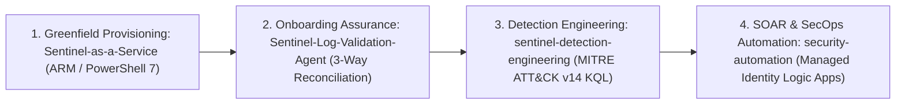

# Microsoft Sentinel — Detections, Onboarding Assurance & Automation

[**← Back to Portfolio Index**](README.md) · [**Security Architecture →**](security-architecture.md) · [**AI Agents →**](ai-agents.md) · [**Books & Learning →**](books-and-learning.md) · [**Experience & Impact →**](experience-and-impact.md)

---

## Specialization Overview

Microsoft Sentinel is a core technical specialization across my enterprise security architecture practice and my engineering repositories.

My Sentinel engineering work addresses the four points where enterprise SIEM deployments most often fail:

> **Related AI Agent Work:** For my **AI-Assisted Microsoft Sentinel Detection Engineering Agent (`ai-agent-usecase-deployment` V3.4)**—which automates telemetry discovery, KQL generation, deterministic validation, historical backtesting, and human-approved deployment—see its primary case study in [**`ai-agents.md#1-ai-assisted-microsoft-sentinel-detection-engineering-agent-ai-agent-usecase-deployment-v34`**](ai-agents.md#1-ai-assisted-microsoft-sentinel-detection-engineering-agent-ai-agent-usecase-deployment-v34).

---

## 1. Sentinel Log Validation Agent (`Sentinel-Log-Validation-Agent`)

- **Visitor Access:** **Public case study with implementation currently private** (`86sunbot/Sentinel-Log-Validation-Agent` is currently private and scheduled for Stage B clean-history companion release).

### Problem and Audience
- **Problem:** In enterprise SIEM operations, "connector enabled" rarely equals "detection ready." Silent log drop-offs, unassociated Data Collection Rules (DCRs), broken ASIM field mappings, and unmonitored Analytics-tier ingestion costs create blind spots that are only discovered during an incident.
- **Audience:** SOC Engineering Leads, SIEM Architects, Detection Engineers, and MSSP Onboarding Teams.

### Current Capabilities (Documented in Case Study)
- **Four-State Deterministic Verdicts (`PASS` / `WARN` / `FAIL` / `UNKNOWN`):** Explicitly separates healthy telemetry (`PASS`), degraded SLAs (`WARN`), broken pipelines (`FAIL`), and unverified/zero-volume threat categories (`UNKNOWN`—preventing zero-event tables from being falsely marked healthy).
- **Three-Way Asset Reconciliation (`engine/reconciliation.py`):** Cross-checks expected asset inventories against Azure control-plane DCR associations and data-plane KQL heartbeats to classify `SHADOW` (logging but undocumented), `SILENT` (configured but not emitting), and `UNASSOCIATED_DCR` assets.
- **Synthetic Canary Verification (`engine/canary.py`):** Generates and verifies deterministic canary markers across multi-hop collection pipelines (`Device -> Forwarder -> AMA -> Workspace`) to prove end-to-end field preservation.
- **Source Profiles & ASIM Scoring (`profiles/` & `engine/asim.py`):** Deep validation profiles for **Palo Alto PAN-OS (`CommonSecurityLog`)**, **Windows Security Events (`SecurityEvent` via AMA)**, and **Microsoft Entra ID (`SigninLogs` / `AuditLogs`)**, plus automated ASIM schema compliance scoring.
- **FinOps Ingestion Modeling (`engine/cost.py`):** Evaluates Analytics vs. Basic vs. Auxiliary log tier economics and flags high-volume low-detection-yield tables.
- **Tamper-Evident Evidence & Interactive Workbench (`evidence/` & `web/`):** Emits SHA-256 hash-verified JSON/Markdown audit artifacts and includes a local FastAPI web workbench (`http://127.0.0.1:8765`) plus Bounded AI SOC Co-Pilot advisory summaries.

### Maturity / Status
- **Working Engineering Prototype (Locally Tested · Root License Selection Pending; `pyproject.toml` declares `MIT`):** Complete Python CLI (`sentinel-log-validator`) and FastAPI web workbench supporting deterministic offline mock scenarios (`healthy`, `silent_drop`, `parser_drift`, `zero_threat_volume`, `onboarding_gap`) and live Azure (`DefaultAzureCredential`) validation.

### Evidence and Limitations
- **Defined vs. Locally Executed Automated Tests:** **`130` automated tests defined** across 27 test modules; **`130` locally executed and passed via `pytest` (`1.60s`)** alongside `.venv/bin/ruff check src tests` (`0` errors) and offline CLI execution (`sentinel-log-validator validate --mode mock`).
- **Sanitized Synthetic Sample Provenance:** The committed sample artifact `artifacts/sample_evidence.json` has been updated with explicit provenance metadata (`artifact_provenance: "SYNTHETIC_SANITIZED_SAMPLE"`, `sanitized_at: "2026-10-10T00:00:00Z"`) and synthetic placeholder resource/subscription identifiers (`00000000-0000-0000-0000-000000000001`). It is a sanitized synthetic example, not an unaltered live Azure dump.
- **Documented Pattern Scan & Identifier vs. Credential Distinction:**
  - *Scan Scope:* Regex pattern scans for common secret prefixes, private keys, Azure GUIDs, and email addresses detected **no authentication credentials/secrets** in `HEAD` or Git history.
  - *Non-Secret Identifiers in Git History:* While `HEAD` (`07c2ab3`) replaces personal Azure identifiers with synthetic placeholders, ancestor commits on `main` (`ef895fa`) still contain **non-secret cloud/personal identifiers** (personal lab Azure Subscription/Tenant GUIDs and personal email/hostname in commit metadata). Although these identifiers are not authentication secrets and do not require credential rotation, Stage B publication will use a clean-history public companion repository to avoid exposing personal tenant metadata.

### Canonical Source & Access Status
- **Access Status:** **Public case study with implementation currently private** (`86sunbot/Sentinel-Log-Validation-Agent`, prepared on local branch `portfolio/remediation-2026-10` at commit `07c2ab3` — Stage B candidate pending clean-history companion export and explicit license selection).

---

## 2. Sentinel-as-a-Service — Greenfield Deployment Kit & Orchestrator (`Sentinel-as-a-Service`)

- **Visitor Access:** **Public case study with implementation currently private** (`86sunbot/Sentinel-as-a-Service` is currently private).

### Problem and Audience
- **Problem:** Greenfield Microsoft Sentinel deployments frequently suffer from manual portal configuration drift, inconsistent table-level retention policies, missing RBAC separation, and unvalidated connector/rule prerequisites.
- **Audience:** Cloud Security Architects, SecOps Deployment Engineers, and MSSP Delivery Teams provisioning new Microsoft Sentinel environments.

### Current Capabilities (Documented in Case Study)
- **10-Stage Guided Web Configuration Wizard (`ui/`):** Browser-based configuration studio (`http://localhost:3001`) that captures tenant/subscription parameters, Log Analytics SKU/commitment tiers, table-level hot/archive retention, RBAC role assignments, Data Collection Rules (DCRs), data connectors, analytics rules, and Logic App SOAR playbooks, exporting a validated `sentinel-config.json`.
- **Three-Level Preflight Validation Engine (`validation/`):**
  - *Level 1 (Schema):* Enforces strict types, GUID formats, SKU constraints, and CIDR/retention bounds (`scripts/validate-config.js`).
  - *Level 2 (ARM Template Structure):* Validates ARM template schema, parameters, resources, and Logic App workflow definitions (`scripts/validate-templates.js`).
  - *Level 3 (Live Azure ARM Preflight):* Checks RBAC permissions, resource provider registration (`Microsoft.OperationalInsights`, `Microsoft.SecurityInsights`), and quota availability (`modules/`).
- **Idempotent PowerShell 7 ARM REST Orchestrator (`Deploy-SentinelKit.ps1` & `modules/`):** Modular PowerShell 7 scripts executing ARM REST API calls with `-WhatIf` dry-run support and post-deployment verification (`Test-SentinelDeployment.ps1`).

### Maturity / Status
- **Working Infrastructure-as-Code & Web Orchestrator Prototype (Existing Root `MIT` License Preserved):** Node.js wizard config validator (`validation/config-validator/validator.js`) locally executed; PowerShell Pester suite (`tests/SentinelKit.Tests.ps1`) defined for GitHub Actions CI.

### Evidence and Limitations
- **Defined vs. Locally Executed Tests & Validation Scope:**
  - **Locally Executed (Node.js Wizard Schema Validator & JSON/CSV Parse):** Executed `validation/config-validator/validator.js` via Node.js on `config/examples/enterprise-soc-greenfield.json` (**`valid: true`, `0` L1/L2 errors**) and verified JSON/CSV parsing on `config/sentinel-config.json`, `config/sentinel-config.greenfield.json`, `config/high_value_assets.csv`, and `config/templates/*.json`. Note that the Web UI Wizard schema (`config/examples/enterprise-soc-greenfield.json`, which nests `azure` and `resourceGroup` top-level keys) differs from the PowerShell Kit schema (`config/sentinel-config.json`, which nests `subscriptionId` and `resourceGroupName` under `deployment`).
  - **Defined for CI / Historical Run (PowerShell Pester v5):** **`23` Pester v5 `It` test blocks are defined** in `tests/SentinelKit.Tests.ps1` (covering PowerShell AST parsing, `PSScriptAnalyzer`, CSV watchlist integrity, and KQL CRLF sanitization). These were **not executed locally** during this review because PowerShell 7 (`pwsh`) is not installed on the local macOS host; they are configured to run on `ubuntu-latest` in `.github/workflows/lint-and-test.yml`.
- **Sanitized Synthetic Artifact Provenance:** `artifacts/02_VERIFICATION_REPORT.md` and the three deployment evidence files in `artifacts/deployments/*.json` have been marked with explicit provenance metadata (`ArtifactProvenance: "SYNTHETIC_SANITIZED_SAMPLE"` / `"SYNTHETIC_SANITIZED_REPORT"`, `SanitizedAt: "2026-10-10T00:00:00Z"`) indicating that original subscription names and Azure GUIDs were replaced with synthetic placeholders (`00000000-0000-4000-8000-000000000001`).
- **Documented Pattern Scan & Identifier vs. Credential Distinction:**
  - *Scan Scope:* Regex pattern scans across `HEAD` and Git history detected **no authentication credentials/secrets**.
  - *Non-Secret Identifiers in Git History:* Earlier commit `00e4c05` on `main` contains **non-secret cloud identifiers** (personal lab Azure Subscription/Tenant GUIDs and subscription display name) plus the deleted 6.2 MB duplicate MP4 blob. Public release requires a clean-history companion repository.

### Canonical Source & Access Status
- **Access Status:** **Public case study with implementation currently private** (`86sunbot/Sentinel-as-a-Service`, prepared on local branch `portfolio/remediation-2026-10` at commit `f6e561d`).

---

## 3. Sentinel Detection Engineering Library (`sentinel-detection-engineering`)

- **Visitor Access:** **Public case study with implementation currently private** (`86sunbot/sentinel-detection-engineering` is currently private and scheduled for Stage B public release).

### Problem and Audience
- **Problem:** Many KQL detection repositories share raw queries without false-positive tuning guidance, log-source prerequisite checks, blind-spot disclosures, or quality scoring standards—leading to alert fatigue in production SOCs.
- **Audience:** Detection Engineers, Threat Hunters, and SOC Analysts operating Microsoft Sentinel.

### Current Capabilities & Detection Examples (Documented in Case Study)
- **Six MITRE ATT&CK-Aligned Detection Specifications (`detections/`):**
  1. **MFA Fatigue / Push Bombing (`identity/mfa-fatigue-attack.yaml`):** Maps to `T1621` (`Credential Access`); detects repeated MFA push denials (`ResultType == 500121`) followed by approval or threshold breach within a 15-minute window in `SigninLogs`.
  2. **Impossible Travel with False-Positive Reduction (`identity/impossible-travel.yaml`):** Maps to `T1078` (`Initial Access`); calculates Haversine geolocation velocity between consecutive sign-ins while filtering corporate VPN egress ranges and same-ASN mobile transitions.
  3. **Pass-the-Hash Lateral Movement (`lateral-movement/pass-the-hash.yaml`):** Maps to `T1550.002` (`Lateral Movement`); detects NTLM network logons (`EventID == 4624`, `LogonType == 3`, `AuthenticationPackageName == 'NTLM'`, `KeyLength == 0`) excluding machine accounts.
  4. **Privileged Entra ID Role Assignment Outside PIM (`persistence/privileged-role-assignment.yaml`):** Maps to `T1098.003` (`Persistence` / `Privilege Escalation`); monitors `AuditLogs` for permanent assignments to Tier-0 roles (`Global Administrator`, `Privileged Role Administrator`, `Security Administrator`) outside PIM activation workflows.
  5. **Mass Azure Blob Storage Exfiltration (`cloud/azure-storage-exfiltration.yaml`):** Maps to `T1530` (`Collection` / `Exfiltration`); uses 14-day baseline anomaly math (`avg` + `3 * stdev`) on `StorageBlobLogs` to flag anomalous egress volumes or bulk downloads.
  6. **DNS Tunneling & High-Entropy Subdomain Exfiltration (`exfiltration/dns-tunneling.yaml`):** Maps to `T1071.004` & `T1048.003`; analyzes `DnsEvents` for long subdomain labels, high query volume per parent domain, and high distinct-subdomain ratios.
- **Detection Engineering Methodology (`methodology/`):**
  - `detection-engineering-philosophy.md`: Signal-to-noise discipline, threat-informed defense, and mandatory blind-spot disclosure.
  - `detection-quality-standard.md`: 100-point rubric across schema completeness, KQL structure, entity mapping, false-positive guidance, and triage runbooks.
  - `use-case-onboarding-process.md`: 7-stage lifecycle from threat hypothesis through shadow-mode tuning and production promotion.
- **MITRE ATT&CK Navigator Layer (`docs/mitre-navigator-layer.json`):** Importable ATT&CK v14 JSON layer.

### Maturity / Status
- **Reference Detection Library & Methodology Standard (Static Schema Validated · Existing Root `MIT` License Preserved):** All 6 YAML detection files pass static schema and string checks.

### Evidence and Limitations
- **Schema Validation vs. Live KQL Execution & Effectiveness:**
  - **Defined & Locally Executed Checks:** The Python validator in `.github/workflows/validate-detections.yml` was executed locally across all **6 YAML detection files (`6/6 passed`)**.
  - **Exact Validation Scope:** This check verifies **YAML syntax (`yaml.safe_load`), 18 required schema fields, MITRE ATT&CK tactic/technique regex formatting, unique rule UUIDs, `TimeGenerated` filter presence, and KQL string length (`> 50` chars)**. It does **not** compile or execute KQL queries against a live Microsoft Sentinel / Log Analytics workspace or measure empirical detection effectiveness (precision, recall, or false-positive rate).
- **Documented Pattern Scan:** Regex scans across `HEAD` and full Git history (`git log --all -p`) for credential prefixes, private keys, Azure GUIDs, and personal email addresses found **no matching credential or personal identifier patterns**.

### Canonical Source & Access Status
- **Access Status:** **Public case study with implementation currently private** (`86sunbot/sentinel-detection-engineering`, prepared on local branch `portfolio/remediation-2026-10` at commit `9e089a1` — Stage B candidate).

---

## 4. Security Operations Automation Toolkit (`security-automation`)

- **Visitor Access:** **Public case study with implementation currently private** (`86sunbot/security-automation` is currently private).

### Problem and Audience
- **Problem:** SOC analysts spend excessive time on repetitive account-containment actions, manual Entra ID hygiene audits, and recurring threat hunts across Azure estates.
- **Audience:** SecOps Engineers, Cloud Security Administrators, and Incident Responders.

### Current Capabilities (Documented in Case Study)
- **Managed-Identity Sentinel SOAR Playbook (`playbooks/sentinel/Disable-EntraID-Account-On-High-Risk.json`):** Azure Logic App ARM template triggered by Microsoft Sentinel incidents that uses a **System-Assigned Managed Identity** (no stored client secrets) to disable compromised Entra ID accounts, revoke refresh tokens (`revokeSignInSessions`), post adaptive cards to Microsoft Teams, and append audit comments to the Sentinel incident.
- **PowerShell Security Auditors (`powershell/`):**
  - `entra-id/Get-StaleAccounts.ps1`: Audits Entra ID via Microsoft Graph for dormant accounts (`SignInActivity`), flags privileged stale accounts, exports CSV/HTML reports, and supports `-DisableStaleAccounts -WhatIf`.
  - `azure-security/Get-StoragePublicAccess.ps1`: Scans Azure subscriptions for Storage Accounts permitting public blob access, weak TLS versions (`< TLS 1.2`), or missing HTTPS enforcement.
  - `powershell/sentinel/`: Operational utilities for exporting Sentinel incidents and backing up analytics rules via Az PowerShell.
- **KQL Threat Hunting Queries (`kql-hunting-queries/`):**
  - `identity/stale-admin-accounts.kql`: Correlates privileged role assignments with 60-day `SigninLogs` inactivity.
  - `lateral-movement/suspicious-service-account-activity.kql`: Flags service principals or service accounts performing interactive logons (`LogonType 2/10`) or multi-host lateral movement.

### Maturity / Status
- **Operational Script & Template Toolkit (Existing Root `MIT` License Preserved):** Self-contained ARM template, PowerShell scripts with `[CmdletBinding(SupportsShouldProcess)]`, and KQL hunting queries.

### Evidence and Limitations
- **Validation Scope:** ARM JSON syntax for `Disable-EntraID-Account-On-High-Risk.json` was validated locally via Python `json.load`. PowerShell scripts (`*.ps1`) and KQL hunting queries (`*.kql`) were reviewed statically; **no automated test suite is defined in this repository**, and PowerShell runtime/AST checks were not executed locally (`pwsh` not installed on local macOS host).
- **Documented Pattern Scan:** Regex scans across `HEAD` and full Git history (`git log --all -p`) found no authentication credentials or real Azure GUIDs (only placeholder `xxxxxxxx-...` strings in earlier commits).

### Canonical Source & Access Status
- **Access Status:** **Public case study with implementation currently private** (`86sunbot/security-automation`, prepared on local branch `portfolio/remediation-2026-10` at commit `7a7b3c5`).
