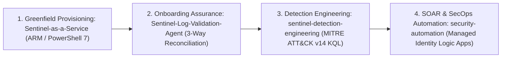
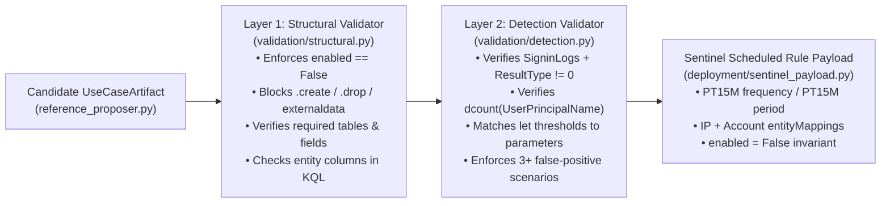

# Microsoft Sentinel — Detections, Onboarding Assurance & Automation

[**← Back to Portfolio Index**](README.md) · [**Security Architecture →**](security-architecture.md) · [**AI Agents →**](ai-agents.md) · [**Books & Learning →**](books-and-learning.md) · [**Experience & Impact →**](experience-and-impact.md)

---

## Specialization Overview

Microsoft Sentinel is a core technical specialization across my enterprise security architecture practice and my engineering repositories.

My Sentinel engineering work addresses the four points where enterprise SIEM deployments most often fail:



> **Related AI Agent Work:** For the governed agent workflow that wraps this KQL detection and validator (`workflow.py`, `gateway.py`) and its multi-table V3.4 evolution (`ai-agent-usecase-deployment`), see [**`ai-agents.md#1-public-flagship-example-governed-ai-sentinel-rule-generation-workflow-fde-labsentinel-usecase-deployment`**](ai-agents.md#1-public-flagship-example-governed-ai-sentinel-rule-generation-workflow-fde-labsentinel-usecase-deployment).

---

## 1. Public Flagship Example: Entra ID Password Spray KQL Detection & Two-Layer Validator (`fde-lab/sentinel-usecase-deployment`)

- **Visitor Access:** **Public source and demo instructions available now** in [`86sunbot/fde-lab/sentinel-usecase-deployment`](https://github.com/86sunbot/fde-lab/tree/main/sentinel-usecase-deployment) ([`reference_proposer.py`](https://github.com/86sunbot/fde-lab/blob/main/sentinel-usecase-deployment/src/sentinel_usecase/agent/reference_proposer.py), [`structural.py`](https://github.com/86sunbot/fde-lab/blob/main/sentinel-usecase-deployment/src/sentinel_usecase/validation/structural.py), [`detection.py`](https://github.com/86sunbot/fde-lab/blob/main/sentinel-usecase-deployment/src/sentinel_usecase/validation/detection.py), and [`sentinel_payload.py`](https://github.com/86sunbot/fde-lab/blob/main/sentinel-usecase-deployment/src/sentinel_usecase/deployment/sentinel_payload.py)).

### Problem and Intended Users
- **Problem:** Detection engineers writing Microsoft Sentinel Scheduled analytics rules for identity attacks (such as single-IP password spraying against `SigninLogs`) must ensure that parameterized KQL thresholds match rule metadata, required output columns (`IPCustomEntity`, `AccountCustomEntity`) exist for incident entity mapping, destructive KQL operators are blocked, and newly generated rules cannot be deployed in an active state before shadow-mode tuning.
- **Intended Users:** Microsoft Sentinel Detection Engineers, Threat Hunters, and SecOps Engineers.

### Architecture Diagram


### Representative Artifact Visitors Can Inspect Now
The complete Scheduled KQL analytics rule and entity mappings below are publicly inspectable in [**`fde-lab/sentinel-usecase-deployment/src/sentinel_usecase/agent/reference_proposer.py`**](https://github.com/86sunbot/fde-lab/blob/main/sentinel-usecase-deployment/src/sentinel_usecase/agent/reference_proposer.py):

```kql
let DetectionWindow = 15m;
let MinimumDistinctAccounts = 10;
let MinimumFailedAttempts = 20;
let SprayCandidates =
    SigninLogs
    | where TimeGenerated >= ago(DetectionWindow)
    | where isnotempty(IPAddress) and isnotempty(UserPrincipalName)
    | where ResultType != "0"
    | extend NormalizedUserPrincipalName = tolower(UserPrincipalName)
    | summarize
        StartTimeUtc = min(TimeGenerated),
        EndTimeUtc = max(TimeGenerated),
        FailedAttempts = count(),
        TargetedAccountCount = dcount(NormalizedUserPrincipalName),
        SampleAccounts = make_set(NormalizedUserPrincipalName, 25),
        SampleApplications = make_set(AppDisplayName, 10),
        FailureCodes = make_set(tostring(ResultType), 10)
      by IPAddress;
SprayCandidates
| where TargetedAccountCount >= MinimumDistinctAccounts and FailedAttempts >= MinimumFailedAttempts
| mv-expand TargetAccount = SampleAccounts to typeof(string)
| extend
    AccountName = tostring(split(TargetAccount, "@")[0]),
    UPNSuffix = tostring(split(TargetAccount, "@")[1]),
    IPCustomEntity = IPAddress,
    AccountCustomEntity = TargetAccount
| project
    StartTimeUtc,
    EndTimeUtc,
    IPAddress,
    IPCustomEntity,
    TargetAccount,
    AccountCustomEntity,
    AccountName,
    UPNSuffix,
    TargetedAccountCount,
    FailedAttempts,
    FailureCodes,
    SampleApplications
```

- **MITRE ATT&CK v14 Mapping:** `CredentialAccess` — `T1110` (*Brute Force*), `T1110.003` (*Password Spraying*).
- **Entity Mappings (`entityMappings`):** Maps `IP` (`Address -> IPCustomEntity`) and `Account` (`Name -> AccountName`, `UPNSuffix -> UPNSuffix`).
- **Two-Layer Validator Source:** Inspect [`validation/structural.py`](https://github.com/86sunbot/fde-lab/blob/main/sentinel-usecase-deployment/src/sentinel_usecase/validation/structural.py) and [`validation/detection.py`](https://github.com/86sunbot/fde-lab/blob/main/sentinel-usecase-deployment/src/sentinel_usecase/validation/detection.py).

### Setup and Reproduction Instructions
```bash
git clone https://github.com/86sunbot/fde-lab.git
cd fde-lab/sentinel-usecase-deployment
python3 -m venv .venv && source .venv/bin/activate
pip install -r requirements.txt -r requirements-dev.txt
ruff check .
PYTHONPATH=src pytest -q tests
# Generate the validated offline reference bundle in artifacts/<use_case_id>/
python run.py create "Create a password spray detection for Entra ID sign-in logs" --offline-reference
```

### Validation Evidence and Known Limitations
- **Validation Evidence:** **`28` automated `pytest` tests defined and passing (`28 passed in 0.04s`)** across 5 test modules in [`sentinel-usecase-deployment/tests/`](https://github.com/86sunbot/fde-lab/tree/main/sentinel-usecase-deployment/tests) (specifically [`test_validation.py`](https://github.com/86sunbot/fde-lab/blob/main/sentinel-usecase-deployment/tests/test_validation.py) verifying rejection of missing `SigninLogs`, mismatched `let` thresholds, missing entity mappings, or `enabled = True`), plus `ruff check .` (`0` errors).
- **Known Limitations:**
  - `validation/structural.py` and `validation/detection.py` perform **static and semantic string/regex validation** against the supported V1 pattern catalogue; they do **not** compile KQL against the Microsoft Kusto engine or execute queries against a live Azure Log Analytics workspace.
  - This public module is the frozen V1 baseline limited to the Entra ID single-IP password spray pattern; multi-table detection specifications and live workspace grounding are covered in the private case studies below.

### Contribution and Third-Party Attribution
- **My Contribution:** Designed and implemented the `UseCaseArtifact` schema, the `SigninLogs` password-spray KQL rule (`reference_proposer.py`), the two-layer validator (`structural.py`, `detection.py`), the Sentinel Scheduled payload serializer (`sentinel_payload.py`), and the 28-test `pytest` suite.
- **Third-Party Attribution:** Uses standard open-source Python packages (`pydantic`, `pytest`, `ruff`); contains no third-party detection content.

---

## 2. Sentinel Log Validation Agent (`Sentinel-Log-Validation-Agent`)

- **Visitor Access:** **Public case study with implementation currently private** (`86sunbot/Sentinel-Log-Validation-Agent` is currently private and scheduled for Stage B clean-history companion release).

### Problem and Audience
- **Problem:** In enterprise SIEM operations, "connector enabled" rarely equals "detection ready." Silent log drop-offs, unassociated Data Collection Rules (DCRs), broken ASIM field mappings, and unmonitored Analytics-tier ingestion costs create blind spots that are only discovered during an incident.
- **Audience:** SOC Engineering Leads, SIEM Architects, Detection Engineers, and MSSP Onboarding Teams.

### Current Capabilities (Documented in Case Study)
- **Four-State Deterministic Verdicts (`PASS` / `WARN` / `FAIL` / `UNKNOWN`):** Explicitly separates healthy telemetry (`PASS`), degraded SLAs (`WARN`), broken pipelines (`FAIL`), and unverified/zero-volume threat categories (`UNKNOWN`—preventing zero-event tables from being falsely marked healthy).
- **Three-Way Asset Reconciliation (`engine/reconciliation.py`):** Cross-checks expected asset inventories against Azure control-plane DCR associations and data-plane KQL heartbeats to classify `SHADOW` (logging but undocumented), `SILENT` (configured but not emitting), and `UNASSOCIATED_DCR` assets.
- **Synthetic Canary Verification (`engine/canary.py`):** Generates and verifies deterministic canary markers across multi-hop collection pipelines (`Device -> Forwarder -> AMA -> Workspace`) to prove end-to-end field preservation.
- **Source Profiles & ASIM Scoring (`profiles/` & `engine/asim.py`):** Deep validation profiles for **Palo Alto PAN-OS (`CommonSecurityLog`)**, **Windows Security Events (`SecurityEvent` via AMA)**, and **Microsoft Entra ID (`SigninLogs` / `AuditLogs`)**, plus automated ASIM schema compliance scoring.
- **FinOps Ingestion Modeling (`engine/cost.py`):** Evaluates Analytics vs. Basic vs. Auxiliary log tier economics and flags high-volume low-detection-yield tables.
- **Tamper-Evident Evidence & Interactive Workbench (`evidence/` & `web/`):** Emits SHA-256 hash-verified JSON/Markdown audit artifacts and includes a local FastAPI web workbench (`http://127.0.0.1:8765`) plus Bounded AI SOC Co-Pilot advisory summaries.

### Maturity / Status
- **Working Engineering Prototype (Locally Tested · Root License Selection Pending; `pyproject.toml` declares `MIT`):** Complete Python CLI (`sentinel-log-validator`) and FastAPI web workbench supporting deterministic offline mock scenarios (`healthy`, `silent_drop`, `parser_drift`, `zero_threat_volume`, `onboarding_gap`) and live Azure (`DefaultAzureCredential`) validation.

### Evidence and Limitations
- **Defined vs. Locally Executed Automated Tests:** **`130` automated tests defined** across 27 test modules; **`130` locally executed and passed via `pytest` (`1.60s`)** alongside `.venv/bin/ruff check src tests` (`0` errors) and offline CLI execution (`sentinel-log-validator validate --mode mock`).
- **Sanitized Synthetic Sample Provenance:** The committed sample artifact `artifacts/sample_evidence.json` has been updated with explicit provenance metadata (`artifact_provenance: "SYNTHETIC_SANITIZED_SAMPLE"`, `sanitized_at: "2026-10-10T00:00:00Z"`) and synthetic placeholder resource/subscription identifiers (`00000000-0000-0000-0000-000000000001`). It is a sanitized synthetic example, not an unaltered live Azure dump.
- **Documented Pattern Scan & Identifier vs. Credential Distinction:**
  - *Scan Scope:* Regex pattern scans for common secret prefixes, private keys, Azure GUIDs, and email addresses detected **no authentication credentials/secrets** in `HEAD` or Git history.
  - *Non-Secret Identifiers in Git History:* While `HEAD` (`07c2ab3`) replaces personal Azure identifiers with synthetic placeholders, ancestor commits on `main` (`ef895fa`) still contain **non-secret cloud/personal identifiers** (personal lab Azure Subscription/Tenant GUIDs and personal email/hostname in commit metadata). Although these identifiers are not authentication secrets and do not require credential rotation, Stage B publication will use a clean-history public companion repository to avoid exposing personal tenant metadata.

### Canonical Source & Access Status
- **Access Status:** **Public case study with implementation currently private** (`86sunbot/Sentinel-Log-Validation-Agent`, prepared on local branch `portfolio/remediation-2026-10` at commit `07c2ab3` — Stage B candidate pending clean-history companion export and explicit license selection).

---

## 3. Sentinel-as-a-Service — Greenfield Deployment Kit & Orchestrator (`Sentinel-as-a-Service`)

- **Visitor Access:** **Public case study with implementation currently private** (`86sunbot/Sentinel-as-a-Service` is currently private).

### Problem and Audience
- **Problem:** Greenfield Microsoft Sentinel deployments frequently suffer from manual portal configuration drift, inconsistent table-level retention policies, missing RBAC separation, and unvalidated connector/rule prerequisites.
- **Audience:** Cloud Security Architects, SecOps Deployment Engineers, and MSSP Delivery Teams provisioning new Microsoft Sentinel environments.

### Current Capabilities (Documented in Case Study)
- **10-Stage Guided Web Configuration Wizard (`ui/`):** Browser-based configuration studio (`http://localhost:3001`) that captures tenant/subscription parameters, Log Analytics SKU/commitment tiers, table-level hot/archive retention, RBAC role assignments, Data Collection Rules (DCRs), data connectors, analytics rules, and Logic App SOAR playbooks, exporting a validated `sentinel-config.json`.
- **Three-Level Preflight Validation Engine (`validation/`):**
  - *Level 1 (Schema):* Enforces strict types, GUID formats, SKU constraints, and CIDR/retention bounds (`scripts/validate-config.js`).
  - *Level 2 (ARM Template Structure):* Validates ARM template schema, parameters, resources, and Logic App workflow definitions (`scripts/validate-templates.js`).
  - *Level 3 (Live Azure ARM Preflight):* Checks RBAC permissions, resource provider registration (`Microsoft.OperationalInsights`, `Microsoft.SecurityInsights`), and quota availability (`modules/`).
- **Idempotent PowerShell 7 ARM REST Orchestrator (`Deploy-SentinelKit.ps1` & `modules/`):** Modular PowerShell 7 scripts executing ARM REST API calls with `-WhatIf` dry-run support and post-deployment verification (`Test-SentinelDeployment.ps1`).
- **Consolidated Terraform Greenfield Workspace Module (`terraform/greenfield-workspace/` & `scripts/Enable-LinuxSyslogFacilities.ps1`):** Adapted and sanitized from `86sunbot/Terraform_Sentinel` (`405051c` / `a581dc8`); provisions the Resource Group, `PerGB2018` Log Analytics Workspace, `SecurityInsights` onboarding, native Entra ID / M365 / MDE data connectors, 13 Windows Event Log data sources, optional Key Vault & NSG diagnostic settings (`enabled_metric`), and a custom `DeployIfNotExists` Azure Policy that streams Subscription Activity Logs to Sentinel via a System-Assigned Managed Identity.

### Maturity / Status
- **Working Infrastructure-as-Code & Web Orchestrator Prototype (Existing Root `MIT` License Preserved):** Node.js wizard config validator (`validation/config-validator/validator.js`), provider-backed Terraform validation (`terraform fmt -check` & `terraform validate` with `hashicorp/azurerm` v5.9.0), and PowerShell 7 Pester suite (`tests/SentinelKit.Tests.ps1`, `24/24 passed`) all locally executed and published to `origin/main` (`44ca4b0`).

### Evidence and Limitations
- **Locally Executed Validation vs. Unavailable Live-Cloud Checks:**
  - **Node.js Wizard Schema Validator & JSON/CSV Hygiene:** Executed `validation/config-validator/validator.js` via Node.js on `config/examples/enterprise-soc-greenfield.json` (**`valid: true`, `0` L1/L2 errors**) and verified JSON/CSV parsing on `config/sentinel-config.json`, `config/sentinel-config.greenfield.json`, `config/high_value_assets.csv`, and `config/templates/*.json`. Note that the Web UI Wizard schema (`config/examples/enterprise-soc-greenfield.json`, which nests `azure` and `resourceGroup` top-level keys) differs from the PowerShell Kit schema (`config/sentinel-config.json`, which nests `subscriptionId` and `resourceGroupName` under `deployment`).
  - **Provider-Backed Terraform Formatting & Schema Validation (`44ca4b0`):** Executed `/opt/homebrew/bin/terraform fmt -check` (0 formatting diffs) and `/opt/homebrew/bin/terraform init -backend=false && /opt/homebrew/bin/terraform validate` (`Terraform v1.15.8` with `hashicorp/azurerm v5.9.0`) across `terraform/greenfield-workspace/` -> **`Success! The configuration is valid.`**
  - **PowerShell 7 AST, `PSScriptAnalyzer` & Mocked Pester Suite (`44ca4b0`):** Executed `/opt/homebrew/bin/pwsh -NoProfile -Command "Invoke-Pester -Path ./tests/SentinelKit.Tests.ps1 -Output Detailed"` (`PowerShell 7.6.4`, `Pester 6.2.0`, `PSScriptAnalyzer 1.25.0`) -> **`24 passed, 0 failed in 612ms`**, verifying 0 AST parse errors across all 10 `.ps1` files, 0 `Error`-severity `PSScriptAnalyzer` findings, CSV watchlist integrity, KQL CRLF sanitization, and mocked `New-AzOperationalInsightsLinuxSyslogDataSource` execution in `scripts/Enable-LinuxSyslogFacilities.ps1`.
  - **Unavailable Checks (Not Executed Locally):** Live `terraform plan` / `terraform apply` and live `Deploy-SentinelKit.ps1` execution against an authenticated Azure subscription (`az login` / ARM REST control plane) were not executed in the offline test environment.
- **Sanitized Synthetic Artifact Provenance:** `artifacts/02_VERIFICATION_REPORT.md` and the three deployment evidence files in `artifacts/deployments/*.json` have been marked with explicit provenance metadata (`ArtifactProvenance: "SYNTHETIC_SANITIZED_SAMPLE"` / `"SYNTHETIC_SANITIZED_REPORT"`, `SanitizedAt: "2026-10-10T00:00:00Z"`) indicating that original subscription names and Azure GUIDs were replaced with synthetic placeholders (`00000000-0000-4000-8000-000000000001`).
- **Documented Pattern Scan & Identifier vs. Credential Distinction:**
  - *Scan Scope:* Regex pattern scans across `HEAD` and Git history detected **no authentication credentials/secrets**.
  - *Non-Secret Identifiers in Git History:* Earlier commit `00e4c05` on `main` contains **non-secret cloud identifiers** (personal lab Azure Subscription/Tenant GUIDs and subscription display name) plus the deleted 6.2 MB duplicate MP4 blob. Public release requires a clean-history companion repository.

### Canonical Source & Access Status
- **Access Status:** **Public case study with implementation currently private** (`86sunbot/Sentinel-as-a-Service` on `origin/main` at commit `44ca4b0`, 58 files).

---

## 4. Sentinel Detection Engineering Library (`sentinel-detection-engineering`)

- **Visitor Access:** **Public case study with implementation currently private** (`86sunbot/sentinel-detection-engineering` is currently private and scheduled for Stage B public release).

### Problem and Audience
- **Problem:** Many KQL detection repositories share raw queries without false-positive tuning guidance, log-source prerequisite checks, blind-spot disclosures, or quality scoring standards—leading to alert fatigue in production SOCs.
- **Audience:** Detection Engineers, Threat Hunters, and SOC Analysts operating Microsoft Sentinel.

### Current Capabilities & Detection Examples (Documented in Case Study)
- **Six MITRE ATT&CK-Aligned Detection Specifications (`detections/`):**
  1. **MFA Fatigue / Push Bombing (`identity/mfa-fatigue-attack.yaml`):** Maps to `T1621` (`Credential Access`); detects repeated MFA push denials (`ResultType == 500121`) followed by approval or threshold breach within a 15-minute window in `SigninLogs`.
  2. **Impossible Travel with False-Positive Reduction (`identity/impossible-travel.yaml`):** Maps to `T1078` (`Initial Access`); calculates Haversine geolocation velocity between consecutive sign-ins while filtering corporate VPN egress ranges and same-ASN mobile transitions.
  3. **Pass-the-Hash Lateral Movement (`lateral-movement/pass-the-hash.yaml`):** Maps to `T1550.002` (`Lateral Movement`); detects NTLM network logons (`EventID == 4624`, `LogonType == 3`, `AuthenticationPackageName == 'NTLM'`, `KeyLength == 0`) excluding machine accounts.
  4. **Privileged Entra ID Role Assignment Outside PIM (`persistence/privileged-role-assignment.yaml`):** Maps to `T1098.003` (`Persistence` / `Privilege Escalation`); monitors `AuditLogs` for permanent assignments to Tier-0 roles (`Global Administrator`, `Privileged Role Administrator`, `Security Administrator`) outside PIM activation workflows.
  5. **Mass Azure Blob Storage Exfiltration (`cloud/azure-storage-exfiltration.yaml`):** Maps to `T1530` (`Collection` / `Exfiltration`); uses 14-day baseline anomaly math (`avg` + `3 * stdev`) on `StorageBlobLogs` to flag anomalous egress volumes or bulk downloads.
  6. **DNS Tunneling & High-Entropy Subdomain Exfiltration (`exfiltration/dns-tunneling.yaml`):** Maps to `T1071.004` & `T1048.003`; analyzes `DnsEvents` for long subdomain labels, high query volume per parent domain, and high distinct-subdomain ratios.
- **Detection Engineering Methodology (`methodology/`):**
  - `detection-engineering-philosophy.md`: Signal-to-noise discipline, threat-informed defense, and mandatory blind-spot disclosure.
  - `detection-quality-standard.md`: 100-point rubric across schema completeness, KQL structure, entity mapping, false-positive guidance, and triage runbooks.
  - `use-case-onboarding-process.md`: 7-stage lifecycle from threat hypothesis through shadow-mode tuning and production promotion.
- **MITRE ATT&CK Navigator Layer (`docs/mitre-navigator-layer.json`):** Importable ATT&CK v14 JSON layer.

### Maturity / Status
- **Reference Detection Library & Methodology Standard (Static Schema Validated · Existing Root `MIT` License Preserved):** All 6 YAML detection files pass static schema and string checks.

### Evidence and Limitations
- **Schema Validation vs. Live KQL Execution & Effectiveness:**
  - **Defined & Locally Executed Checks:** The Python validator in `.github/workflows/validate-detections.yml` was executed locally across all **6 YAML detection files (`6/6 passed`)**.
  - **Exact Validation Scope:** This check verifies **YAML syntax (`yaml.safe_load`), 18 required schema fields, MITRE ATT&CK tactic/technique regex formatting, unique rule UUIDs, `TimeGenerated` filter presence, and KQL string length (`> 50` chars)**. It does **not** compile or execute KQL queries against a live Microsoft Sentinel / Log Analytics workspace or measure empirical detection effectiveness (precision, recall, or false-positive rate).
- **Documented Pattern Scan:** Regex scans across `HEAD` and full Git history (`git log --all -p`) for credential prefixes, private keys, Azure GUIDs, and personal email addresses found **no matching credential or personal identifier patterns**.

### Canonical Source & Access Status
- **Access Status:** **Public case study with implementation currently private** (`86sunbot/sentinel-detection-engineering`, prepared on local branch `portfolio/remediation-2026-10` at commit `9e089a1` — Stage B candidate).

---

## 5. Security Operations Automation Toolkit (`security-automation`)

- **Visitor Access:** **Public case study with implementation currently private** (`86sunbot/security-automation` is currently private).

### Problem and Audience
- **Problem:** SOC analysts spend excessive time on repetitive account-containment actions, manual Entra ID and Azure VM hygiene audits, firewall configuration backups, and recurring threat hunts across hybrid estates.
- **Audience:** SecOps Engineers, Cloud & Network Security Administrators, and Incident Responders.

### Current Capabilities & Source Provenance (`origin/main` @ `f0c65c4`)
- **Managed-Identity Sentinel SOAR Playbook (`playbooks/sentinel/Disable-EntraID-Account-On-High-Risk.json`):** Azure Logic App ARM template triggered by Microsoft Sentinel incidents that uses a **System-Assigned Managed Identity** (no stored client secrets) to disable compromised Entra ID accounts, revoke refresh tokens (`revokeSignInSessions`), post adaptive cards to Microsoft Teams, and append audit comments to the Sentinel incident.
- **PowerShell Security & Network Auditors (`powershell/`):**
  - `entra-id/Get-StaleAccounts.ps1`: Audits Entra ID via Microsoft Graph for dormant accounts (`SignInActivity`), flags privileged stale accounts, exports CSV/HTML reports, and supports `-DisableStaleAccounts -WhatIf`.
  - `azure-security/Get-StoragePublicAccess.ps1`: Scans Azure subscriptions for Storage Accounts permitting public blob access, weak TLS versions (`< TLS 1.2`), or missing HTTPS enforcement.
  - `azure-security/Get-AzVmOsInventory.ps1` *(adapted from `PowerShell_Automation:VM-Details` @ `0d7894a` & `VM_Details+Mail` @ `bfc6c28`)*: Inventories Azure VMs across subscriptions by OS family (`Windows` vs. `Linux`) and Linux publisher/offer distribution (`RHEL`, `SUSE`, `Ubuntu`, `Debian`, `OracleLinux`, `CentOS`).
  - `network-security/Backup-PaloAltoFirewallConfig.ps1` & `Test-NetworkEndpointReachability.ps1` *(adapted & sanitized from `Palo-Alto-Codes:PA_FW_BACKUP+MAIL` @ `a7cf333`, `Multiple_FW_Backup+Mail` @ `c836335`, `Ping+Mail` @ `cb004d3`, & `Telnet+Mail` @ `50053c5`)*: Header-authenticated (`X-PAN-KEY` via environment variable over TLS 1.2+) PAN-OS running-configuration XML backup utility with SHA-256 manifest, plus parameterized ICMP/TCP port reachability probing.
  - `sentinel/`: Operational utilities for exporting Sentinel incidents (`Fetch-Sentinel-Incidents.ps1`, `For-Incidents-Loop.ps1`), backing up analytics rules (`Backup-Sentinel-UC.ps1`) and Azure Monitor Scheduled Query Rules (`Backup-AzMonitor-ScheduledQueryRules.ps1`, adapted from `Sentinel:Backup-AzMonitor-Rules` @ `fcea1f3`), and deploying scheduled rules from CSV (`Deploy-AzMonitorAlerts.ps1`, `Deploy-Sentinel-UC-WithoutTactics.ps1`, and `Deploy-AzSentinel-UC-WithTactics.ps1`, adapted from `Sentinel:Deploy-AzSentinel-UC-Tactics` @ `412c3c8`).
- **Python Sentinel & Threat-Intelligence Utilities (`python/`):**
  - `sentinel/convert_sentinel_arm_rules_to_csv.py` *(adapted from `Sentinel:Backup-use-cases_json-to-csv` @ `50fce90` & `archive-data-analysis:json-to-csv` @ `3fdbbbc`)*: Standard-library converter transforming exported Sentinel ARM/REST JSON alert rules into a normalized CSV catalogue.
  - `network-security/subnet_and_ti_utils.py` *(adapted from `Python_Automation:Subnet_Calculator` @ `21ecfe1` & `Blacklisted_DB_Download` @ `44a685a`)*: Pure-Python CIDR subnet calculator/splitter and RFC 1918-filtered threat-intelligence IP watchlist normalizer with SHA-256 provenance.
- **KQL Threat Hunting Queries (`kql-hunting-queries/`):**
  - `identity/stale-admin-accounts.kql`: Correlates privileged role assignments with 60-day `SigninLogs` inactivity.
  - `lateral-movement/suspicious-service-account-activity.kql`: Flags service principals or service accounts performing interactive logons (`LogonType 2/10`) or multi-host lateral movement.

### Maturity / Status
- **Operational Script & Template Toolkit (Existing Root `MIT` License Preserved):** Self-contained ARM template, 12 parameterized PowerShell scripts verified by AST parsing and mocked Pester v6 tests (`tests/SecurityAutomation.Tests.ps1`), pure-Python utilities verified by `pytest` (`tests/test_security_automation.py`), and KQL hunting queries.

### Evidence and Limitations
- **Locally Executed Validation vs. Unavailable Live-Cloud Checks (`f0c65c4`):**
  - **Python Unit Tests (`pytest`):** Executed `/Users/suryap/.gemini/antigravity/scratch/FDE-Final-Capstone/.venv/bin/pytest -v tests/test_security_automation.py` (**`5 passed in 0.03s`**), verifying `convert_sentinel_arm_rules_to_csv.py`, `subnet_and_ti_utils.py`, Logic App ARM template JSON schema and Managed Identity configuration, and regex hygiene across all scripts.
  - **PowerShell 7 AST & Mocked Pester v6 Suite:** Executed `/opt/homebrew/bin/pwsh -NoProfile -Command "Invoke-Pester -Path ./tests/SecurityAutomation.Tests.ps1 -Output Detailed"` (`PowerShell 7.6.4`, `Pester 6.2.0`) -> **`6 passed, 0 failed in 356ms`**, verifying 0 AST parse errors across all 12 `.ps1` scripts (after fixing 4 AST parse errors in `Get-StoragePublicAccess.ps1`) and mocked execution of all 5 newly adapted PowerShell scripts (`Deploy-AzSentinel-UC-WithTactics.ps1`, `Backup-AzMonitor-ScheduledQueryRules.ps1`, `Get-AzVmOsInventory.ps1`, `Backup-PaloAltoFirewallConfig.ps1`, `Test-NetworkEndpointReachability.ps1`).
  - **Unavailable Checks (Not Executed Locally):** Live Microsoft Graph (`Get-MgUser`), Azure ARM/Sentinel cmdlets, and live PAN-OS firewall HTTPS endpoints were mocked via Pester rather than executed against live network targets.
- **Documented Pattern Scan:** Regex scans across `HEAD` and full Git history (`git log --all -p`) of `security-automation` found no authentication credentials, client names, or real Azure GUIDs.

### Canonical Source & Access Status
- **Access Status:** **Public case study with implementation currently private** (`86sunbot/security-automation` on `origin/main` at commit `f0c65c4`, 24 files).
